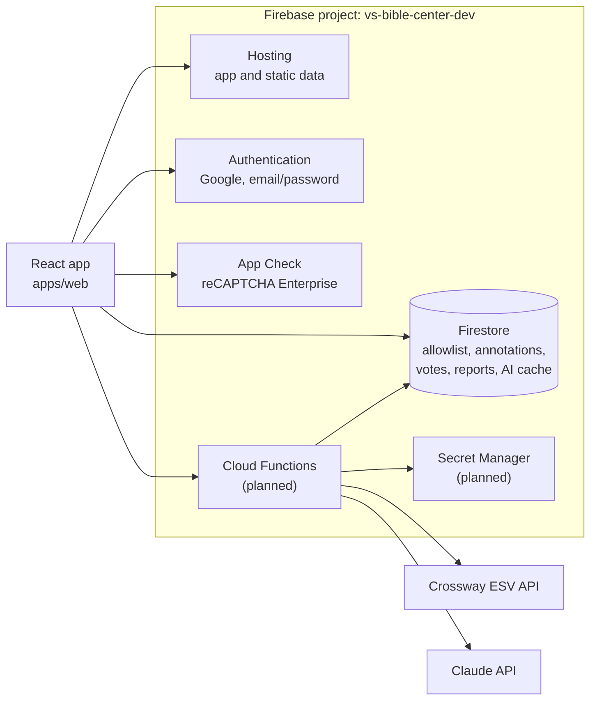
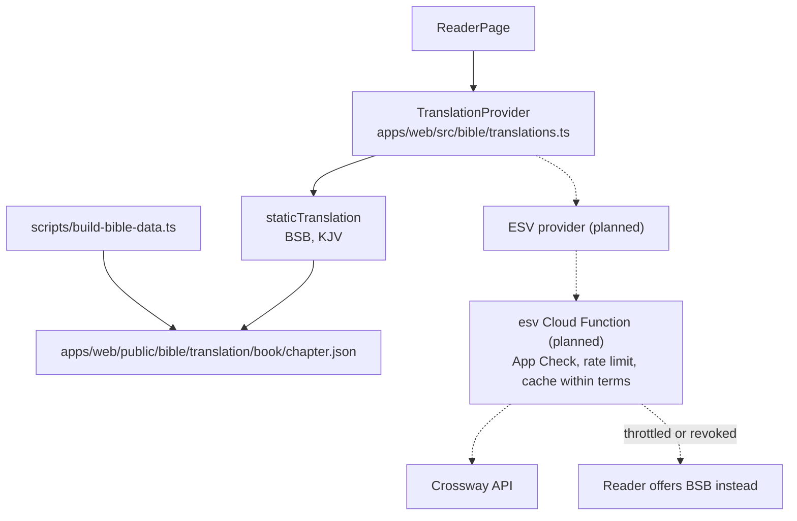
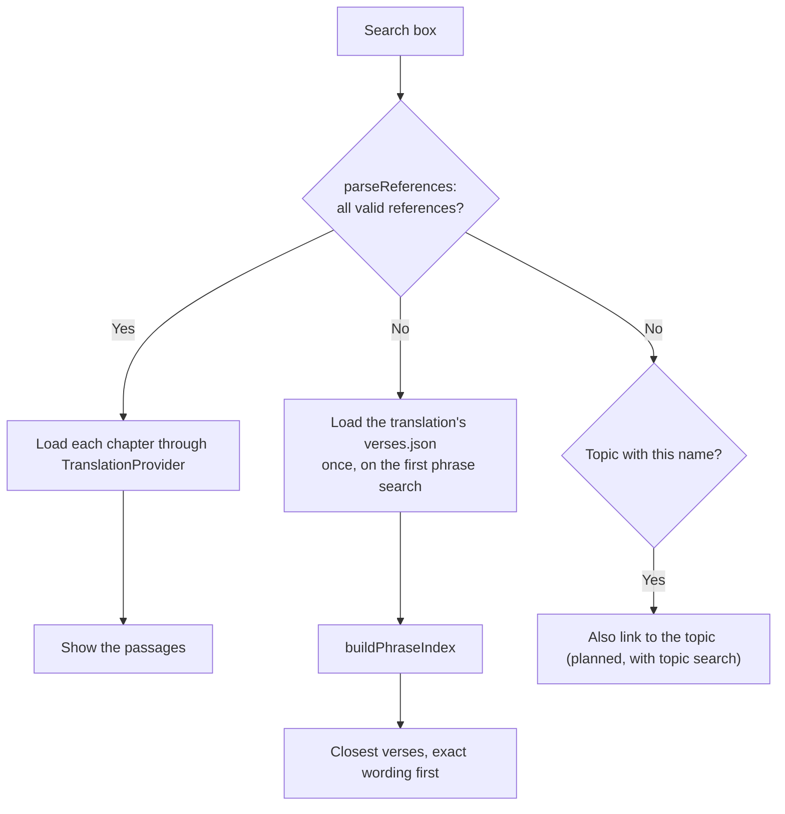
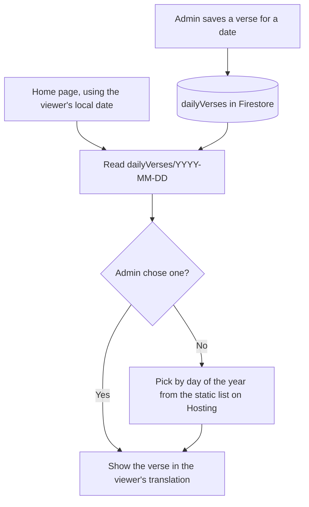
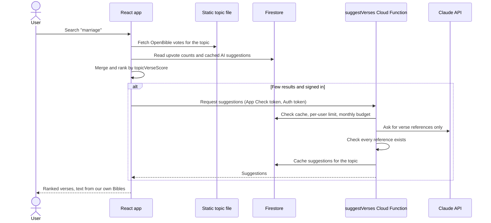
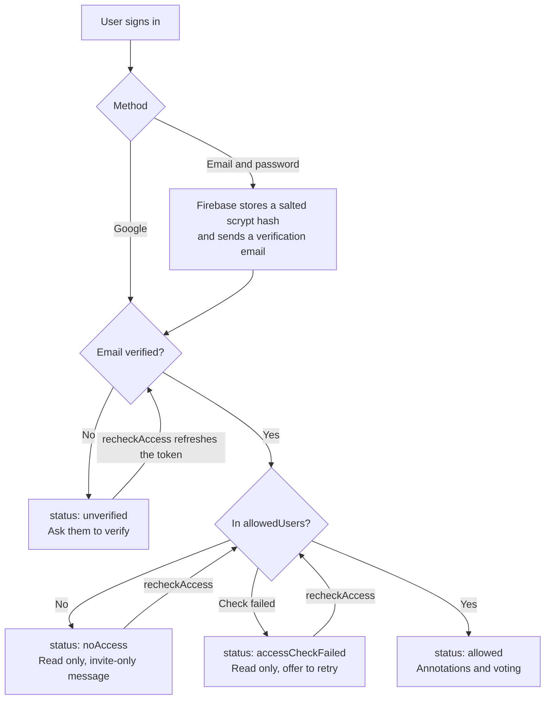
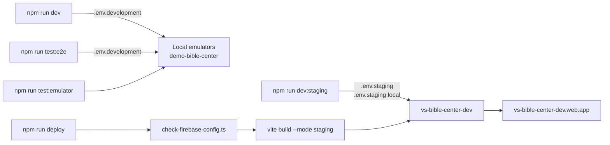

# Architecture

How Bible Center is designed, why, and where the work stands. This is the main handoff document between sessions.

## Project Status

**Current step: annotations.** The mockups are approved.

| Area | Status |
| --- | --- |
| Monorepo, tooling, tests, env files, Firebase and App Check wiring, deploy check | Done |
| Allowlist rule, default-deny Firestore rules | Done, not yet deployed |
| Topic score formula (`packages/core/src/topicScore.ts`) | Done, not yet used by any feature |
| Design mockups | Approved |
| Sign-in and registration | Built. Google sign-in is confirmed on the hosted site; email registration is tested against the emulators only |
| App layout: app bar, thumb index, phone menu, light and dark mode | Built |
| Home page | Built with a fixed verse. Search and topics are added with those features |
| Verse of the Day | Planned |
| Site icon (tab and bookmark) | Built |
| Reader (BSB, KJV), translation switching | Built. The mockup's annotation tools and word panel come with those features |
| Reference and phrase search | Built |
| Annotations | Planned |
| Topic search, voting, reports | Planned |
| Hebrew/Greek study | Planned |
| AI topic suggestions | Planned as the last V1 step |
| ESV | Blocked: Crossway's review of the API key application, applied for November 2026, may take 3-4 weeks |
| Boards, plugins, paraphrase search (embeddings) | After V1 |

### Current State

Last updated November 7, 2026.

- **Repository:** [Valiance-Studios/bible-center](https://github.com/Valiance-Studios/bible-center) is public. The foundation, sign-in, icon and reader are merged. Search is in a pull request from `feature/search`. Check what has merged before starting new work.
- **Hosted project:** `vs-bible-center-dev`. The foundation and Firestore rules are deployed. Its Firebase API key is restricted to the hosted domains and `localhost:5173`; see [DEPLOYMENT.md](docs/DEPLOYMENT.md#api-key-restrictions).
- **Set up in the project:** billing, Firestore `(default)` in `nam5`, Hosting, the web app, the reCAPTCHA Enterprise key, App Check registration, Google and email/password sign-in, and the APIs for Cloud Functions, Cloud Run, Cloud Build, Artifact Registry, Eventarc and Secret Manager. `allowedUsers/bobbyjuba@gmail.com` exists.
- **`gcloud` and Firebase CLI account:** `broden@valiance-studios.com`.

### Next Steps

Build features one branch at a time, from `main` or from the latest unmerged branch: annotations, topic search and voting, Verse of the Day, Hebrew/Greek study, then AI suggestions.

### Open Items

- An Anthropic API key, a Secret Manager entry for it, and a $10 monthly spend limit are needed at the AI step.
- Crossway's decision on the ESV API key. Once approved, the owner adds the key to Secret Manager and shares the secret's name.
- App Check is not enforced on any service yet. See [DEPLOYMENT.md](docs/DEPLOYMENT.md#enforcement).
- The main bundle is about 1.1 MB because every page loads Firebase and Mantine. Signed-out reading should not need Firestore or Auth up front, so split them out when the reader is built.
- The Verse of the Day automatic list needs the owner's review before launch.

## Mockups

[**Open the mockups**](https://claude.ai/artifact/D12B3TA5t5Hahvs9wXbL9v). The canvas is private to its owner until shared from its Share menu, so this link only opens for people given access.

| Artboard | Shows |
| --- | --- |
| `Main.dc.html` | Home with Verse of the Day, search and topics |
| `Reader.dc.html` | Reader with annotations and the Hebrew word panel |
| `ReaderDark.dc.html` | The reader in dark mode |
| `Topic.dc.html` | Topic results. Upvoting re-ranks live with the real formula |
| `TopicAi.dc.html` | A topic with few results, showing AI suggestions |
| `SetVerse.dc.html` | The admin dialog for Verse of the Day |
| `SignIn.dc.html` | Sign in, register, verify email, and not on the allowlist |
| `PhoneHome.dc.html` | Home on a phone |
| `PhoneMenu.dc.html` | The phone menu, with sections and their books |
| `PhoneReader.dc.html` | The reader and word panel on a phone |
| `SearchReferences.dc.html` | Search results for references |
| `SearchPhrase.dc.html` | Search results for a paraphrase, an exact phrase, and a word that is also a topic |
| `SearchEmpty.dc.html` | A search with no matches |
| `PhoneSearch.dc.html` | Search results on a phone |

The canvas is the source of truth for the design. To work from it in a new session, read `project/canvas.json` and any `project/<artboard>` from that URL with the Artifact tool. The design language is in [UI.md](docs/UI.md#design-language).

Scripture in the mockups is the public-domain BSB and OpenBible counts are real. Bible Center upvotes, dates and accounts are samples, and the Hebrew word entries are illustrative until they come from STEPBible's data.

## Scope

Bible Center is a free, public, one-stop Bible resource. The [README](README.md) is the public introduction.

**V1**

- A Verse of the Day on the home page, chosen by an admin or automatically.
- Read the Bible and switch between translations.
- Search by reference (`John 1:1`, `John 1:1-5`, `John 1:1; Acts 2:3-4; Revelation 22:13`) or by a remembered phrase.
- Signed-in users can highlight, bookmark and otherwise annotate verses.
- See the Hebrew and Greek behind the English.
- "What does the Bible say about ___?" topic search, ranked by community upvotes.
- Google sign-in and email/password registration, limited to an allowlist for now.

**After V1: boards.** Signed-in users create titled, infinitely scrolling boards holding photos, text boxes, embedded videos, links to other boards, and titled photo carousels whose navigation wraps in both directions. Items can be tagged and searched. Selecting a result jumps to the item, and for a photo in a carousel, makes that photo active.

**Later, if there is demand: plugins.** Translations and search sit behind interfaces so a plugin system could be added. None is built now.

## System Overview

Public-domain Bible text and OpenBible data are static files, so reading costs almost nothing and needs no backend. Firestore holds only what users create. Cloud Functions exist only for what a browser cannot be trusted with: private API keys and spending limits.



### Repository Layout

| Path | Holds |
| --- | --- |
| `apps/web` | The React app, with its env files, Vite and Playwright config, unit tests in `tests` and E2E specs in `e2e`. `@/` is an alias for its `src`. |
| `packages/core` | `@bible-center/core`: types and pure logic shared across the repo, with no browser or Firebase dependencies. |
| `scripts` | Emulator helpers and the deploy check. |
| `tests` | Tests that belong to the repo as a whole: security rules and scripts. Workspace unit tests live in each workspace's `tests` folder. |
| `functions` | Cloud Functions. Added with the first function. |

## Tech Stack

| Concern | Choice |
| --- | --- |
| UI | React, TypeScript, Mantine, SCSS |
| Routing | React Router |
| State | Zustand for app state, TanStack Query for fetched data |
| Backend | Firebase Authentication, Firestore, Hosting, App Check; Cloud Functions when needed |
| Build | Vite, npm workspaces |
| Tests | Vitest with React Testing Library, Playwright, Firebase emulators |
| Linting | ESLint with `@stylistic` and `react-hooks` |

TypeScript stays on 6.0 until `typescript-eslint` supports 7.

## Bible Text

### Translations

| Translation | Source | Delivery | Status |
| --- | --- | --- | --- |
| Berean Standard Bible (default) | [bereanbible.com/bsb.txt](https://bereanbible.com/bsb.txt), public domain (CC0) | Static files | Built |
| King James Version | [openbible.com/textfiles/kjv.txt](https://openbible.com/textfiles/kjv.txt), the Pure Cambridge Edition. Public domain in the US; see below | Static files | Built |
| English Standard Version | [Crossway API](https://api.esv.org/), non-commercial terms | Cloud Function | Waiting on Crossway |

NIV and NKJV are out of scope: both need paid or publisher licensing.

**KJV outside the US:** in the United Kingdom the KJV remains under a perpetual Crown patent, administered by Cambridge University Press, even though it is public domain elsewhere. The site is reachable from the UK, so review this before any wider launch. The source file brackets words its translators added; the build removes the brackets and keeps the words.

The default is BSB until a visitor picks another translation, which is remembered in that browser (`apps/web/src/stores/translation.ts`). Saving it to a signed-in account, so it follows them between devices, comes with annotations. ESV is not the default because its limits are shared by all users (60 requests a minute, 5,000 a day).

### ESV Rules

These come from Crossway's [API terms](https://api.esv.org/) and constrain the whole app, so check them again before relying on them:

- **ESV text never enters this public repository**, including fixtures, seeds and logs.
- The API key stays in Secret Manager and is only used from Cloud Functions.
- The site cannot charge for access, carry ads or sponsorships, or solicit donations.
- At most 500 verses or half a book, whichever is less, per request, per page and in any cache. Full-text indexing is therefore not possible.
- Each page using the text labels quotations "ESV", links to esv.org, and includes the copyright notice.
- Crossway can revoke access at any time, so the app must keep working without ESV.

### Reading Flow

Translations are interchangeable behind one interface. The reader never knows where text came from, and a new translation means a new provider rather than changes to the reader.



`scripts/build-bible-data.ts` downloads each source, checks that every chapter is present, and writes one JSON file per chapter. The output is committed, so a build needs no network and every change to the text is reviewable. It adds about 14 MB across 2,378 small files, marked as generated in `.gitattributes`. Run `npm run bible-data` only to change a source.

Source files run a psalm's title into verse 1 (`A Psalm of David. The LORD is my shepherd`), so the reader shows it that way rather than as the separate line in the mockup. A verse a translation omits, such as Matthew 17:21 in the BSB, is left out and the numbering shows the gap.

### Verse Identity

Annotations and votes are stored against a `VerseId`, never verse text, so they carry across translations and copyrighted text is not copied into Firestore. A `VerseId` is OpenBible's eight-digit `bbcccvvv` format: John 1:1 is `43001001`. See `packages/core/src/verseId.ts`.

Translations occasionally number verses differently. STEPBible's versification data (TVTMS) is the planned source for mapping them; the first non-matching translation will decide whether it is needed.

### Search

One search box handles references and remembered wording, at `/search?q=` (`apps/web/src/pages/SearchPage.tsx`). It searches the selected translation only. Linking to a topic of the same name is added with topic search.



- **References** (`packages/core/src/references.ts`) accept book names and common abbreviations, ranges, whole chapters, and lists like `John 1:1; Acts 2:3-4; Revelation 22:13`. A search counts as references only if all of it is valid, so everything else falls through to phrase search.
- **Phrases** (`apps/web/src/bible/phraseSearch.ts`) use MiniSearch in the browser over `apps/web/public/bible/<translation>/verses.json`, about 4.5 MB per translation, or 1.3 MB compressed. Exact wording ranks first. Words of four or more letters tolerate typos and match by prefix, shorter ones must match exactly, and a verse needs at least half of the search's words.
- **Paraphrases** often work without AI. Against the real BSB, `I do not consider my life of any value nor as precious to myself` ranks Acts 20:24 first, and `the lord is my sheperd` finds Psalm 23:1 in the top two. Embeddings remain a possible later addition for wording that shares few words with any translation.
- **ESV** cannot be indexed because of the cache limit, so phrase search only covers translations offering `verses.json`.

Indexing takes about 300 ms on a laptop and happens once per translation, and most searches take under 40 ms. It runs on the main thread, so move it to a Web Worker if it proves noticeable on phones. Selecting a phrase result opens the verse in the reader, scrolled to and marked via `#v<verse>`.

## Verse of the Day

The home page shows one verse or short passage each day. An admin can choose it for any date, and any date without a choice gets an automatic pick, so the home page never needs attention.



- **Setting it:** admins get a "Set verse of the day" dialog on the home page. An admin is a verified email with a document at `admins/{lowercase email}`, managed in the Firebase console. Only admins can write to `dailyVerses`, enforced by security rules.
- **Automatic picks:** a static list of about 366 verse ranges, indexed by day of the year, so everyone on the same date sees the same verse and nothing runs on a schedule. The list starts from OpenBible's most-voted short passages and needs a person's review before launch.
- **Storage:** a `VerseId` range, not text, so the verse appears in the viewer's translation. The list and documents hold no scripture.
- **Reading:** anyone can read a single date's document, but not list the collection.

## Topic Search

"What does the Bible say about ___?" ranks verses using three sources: Bible Center upvotes, OpenBible's votes as a starting point, and AI suggestions to fill gaps.



### Ranking

Implemented in `packages/core/src/topicScore.ts`:

```text
seedScore = 20 × log(1 + openBibleVotes) / log(1 + topicMaxOpenBibleVotes)
score     = seedScore + upvotes
```

OpenBible's counts are too large to add directly: Genesis 2:24 has 2,953 votes for "marriage", so Bible Center's votes could never change the order. The log scale keeps OpenBible's order but compresses each topic to a 0-20 starting score. For "marriage", the top verse starts at 20 and a verse with 14 votes starts at about 7.

Each upvote adds 1, so 21 upvotes put a verse with no OpenBible votes ahead of that topic's top verse. As the community grows, its votes outweigh the seed without any migration. To change how quickly that happens, change `MAX_SEED_SCORE`.

The app shows OpenBible and Bible Center counts separately rather than the combined score.

### Voting

- Upvotes only. Users can remove their own upvote, and can report an entry that does not belong.
- Signed-in users can upvote an existing verse or associate a verse with a topic.
- One vote per user for each verse and topic, enforced by the document path and security rules.
- Counts are maintained server-side, since a client could otherwise write any count.
- Reports go to a queue for review. They do not change the ranking automatically, so they cannot be used to bury verses.
- Topic names are normalized (trimmed, lowercased). Free-text topics will need moderation before the allowlist is removed.

### OpenBible Data

[OpenBible.info's topic data](https://www.openbible.info/topics/) is licensed CC BY, so the app must credit it with a link wherever it is shown. The [vote file](https://a.openbible.info/data/topic-votes.txt) is refreshed weekly upstream and contains only topics, verse references and vote counts, with no scripture text. As of November 2026 it has about 470,000 rows across 6,751 topics. Each row may be a range (`Topic`, `Start Verse ID`, `End Verse ID`, `Votes`).

A script will split it into one static JSON file per topic on Hosting, so it costs no Firestore writes. Refreshing means rerunning the script; Bible Center votes are unaffected.

### AI Suggestions

Claude Opus 5.5 fills gaps only. OpenBible already covers the common topics.

- Only signed-in users can trigger a lookup, with a per-user limit and a hard **$10 monthly** cap.
- Each topic is looked up once. The cached result is shared with everyone.
- The model returns references only. Every reference is checked, and verse text always comes from our own Bibles.
- Suggestions are labeled as AI-suggested, start with a low score, and appear only for topics with few results. Upvotes raise them like any other verse.

Estimated cost at the time of the decision is about $0.03 per new topic ($4 / $20 per million input / output tokens, about 500 input and 1,500 output tokens). Replace this with measured numbers once it runs.

## Original Languages

| Data | Source | License |
| --- | --- | --- |
| Hebrew and Greek tagged text (TAHOT, TAGNT) | [STEPBible](https://github.com/STEPBible/STEPBible-Data) | CC BY 4.0, credit "STEP Bible" with a link |
| Lexicons (TBESH, TBESG) | STEPBible | CC BY 4.0 |

The first version is a word-by-word original-language panel for each verse. It follows the book being read: Hebrew for the Old Testament, including its Aramaic passages in Daniel and Ezra, labeled as Aramaic, and Greek for the New Testament. The mockup shows Hebrew only; Greek uses the same panel, reading left to right. Selecting an English word to see its source word requires tagging data for that translation; BSB's translation tables are the candidate, and their contents have yet to be checked.

## Authentication and Access

Anyone can read the Bible without an account. Signing in unlocks annotations and voting, and for now is limited to an allowlist in `allowedUsers/{lowercase email}`, managed in the Firebase console.



`apps/web/src/stores/auth.ts` holds this status, and `SignInPage` shows the panel for it. The status only shapes the interface; the security rules enforce access.

**The verified-email check is what makes the allowlist safe.** Anyone can register a password account using someone else's address, so an unverified email proves nothing. `firestore.rules` requires `email_verified` before accepting one, and `tests/rules/allowedUsers.spec.ts` covers this.

Firebase handles the password storage. The app never sees or stores a password. Firebase keeps one account per email by default, and a Google sign-in takes over an unverified password account with the same address, removing the password.

## Security

This repository and the app are public, so assume hostile use.

- **Firestore** denies everything unless a collection opts in. Rules validate each field and tests cover them.
- **App Check** starts before Auth and Firestore make requests, and stays off against the emulators. See [DEPLOYMENT.md](docs/DEPLOYMENT.md#app-check-setup).
- **Deploys** are refused without a site key, or with a debug token or emulator flag (`scripts/check-firebase-config.ts`).
- **Secrets** live in Secret Manager. `VITE_` variables end up in the public bundle, so they never hold secrets.
- **Paid or limited services** are reached only through Cloud Functions with App Check, sign-in where appropriate, per-user limits, and a budget cap.
- **Hosting** sends `nosniff`, `X-Frame-Options` and `Referrer-Policy` headers. A Content Security Policy is still to be added, once the app's external origins are settled.

## Environments and Delivery



Staging is production until a separate production project exists. Details are in [DEVELOPMENT.md](docs/DEVELOPMENT.md#environment-files) and [DEPLOYMENT.md](docs/DEPLOYMENT.md).

## Licensing

The code is under [PolyForm Noncommercial 1.0.0](LICENSE): anyone may use, change and share it for noncommercial purposes, but not sell it or charge for it. It is source-available rather than OSI open source, and it does not require people to publish their changes.

Bible text and datasets keep their own licenses, and the app must credit OpenBible and STEP Bible.

## Diagram Index

Before finishing a change, check whether it touches a source below, and update that diagram in the same change. "Planned" diagrams show the approved design; check them against the code when building that feature.

| Diagram | Sources | State |
| --- | --- | --- |
| [System Overview](#system-overview) | `firebase.json`, `apps/web/src/firebase/`, `functions/` | Partly built |
| [Reading Flow](#reading-flow) | `apps/web/src/pages/ReaderPage.tsx`, `apps/web/src/bible/translations.ts`, `scripts/build-bible-data.ts` | Built, ESV planned |
| [Search](#search) | `apps/web/src/pages/SearchPage.tsx`, `packages/core/src/references.ts`, `apps/web/src/bible/phraseSearch.ts`, `scripts/build-bible-data.ts` | Built, topic link planned |
| [Verse of the Day](#verse-of-the-day) | The home page, `dailyVerses` and `admins` rules, the automatic list | Planned |
| [Topic Search](#topic-search) | Topic search, `packages/core/src/topicScore.ts`, `suggestVerses` | Planned |
| [Authentication and Access](#authentication-and-access) | `firestore.rules`, `apps/web/src/stores/auth.ts`, `apps/web/src/pages/SignInPage.tsx` | Built |
| [Environments and Delivery](#environments-and-delivery) | `package.json`, `apps/web/.env.*`, `firebase.json`, `scripts/` | Built |
