# Architecture

How Bible Center is designed, why, and where the work stands. This is the main handoff document between sessions.

## Project Status

**Current step: the About dialog and final polish, in review** in a pull request from `feature/about-and-polish`. Merging it completes V1. Next come the features planned for after V1.

| Area | Status |
| --- | --- |
| Monorepo, tooling, tests, env files, Firebase and App Check wiring, deploy check | Done |
| GitHub Actions CI (`.github/workflows/ci.yml`) | Built. Runs on pull requests and pushes to `main` |
| Firestore rules and indexes: default deny, allowlist, user settings, annotations, topics, daily verses, memory lists | Built and deployed |
| Design mockups | Approved |
| Sign-in and registration | Built. Google sign-in is confirmed on the hosted site; email registration is tested against the emulators only |
| App layout: app bar, thumb index, phone menu, footer, light and dark mode | Built |
| Home page | Built, with Verse of the Day, search and the common topics |
| Verse of the Day | Built: the automatic list, the admin dialog, and `dailyVerses` rules. The list awaits the owner's review |
| Site icon (tab and bookmark) | Built |
| Reader (BSB, KJV), translation switching | Built |
| Reference and phrase search | Built |
| Annotations: highlights, bookmarks, notes, on verses or ranges | Built |
| Translation choice saved to the account | Built |
| My verses page | Built |
| About dialog | Built: a shorter version of the README with data credits, from the footer and the phone menu |
| Topic search, voting, reports | Built: topic pages, the Topics page, voting ranked by `topicVerseScore`, adding verses, starting topics and reports |
| Admins and reviewers | Built: roles on the allowlist, the People page for admins, and the Review page for reported verses and new topics |
| Hebrew/Greek study | Built: the word panel beside the reader, or in a sheet on phones, from STEPBible data |
| Scripture memorization | Built: flash cards, fading words, and the memory list; see [Memorization](#memorization) |
| AI topic suggestions | After V1 |
| ESV | After V1, once Crossway approves the API key |
| Boards, plugins, paraphrase search (embeddings) | After V1 |

### Current State

Last updated November 10, 2026.

- **Repository:** [Valiance-Studios/bible-center](https://github.com/Valiance-Studios/bible-center) is public. Everything through memorization is merged. Check what has merged before starting new work.
- **Hosted project:** `vs-bible-center-dev`, at [vs-bible-center-dev.web.app](https://vs-bible-center-dev.web.app). The owner deploys it; see [DEPLOYMENT.md](docs/DEPLOYMENT.md), which also covers the API key's restrictions and moving the debug token aside before deploying Hosting.
- **Set up in the project:** billing, Firestore `(default)` in `nam5`, Hosting, the web app, the reCAPTCHA Enterprise key, App Check registration, Google and email/password sign-in, and the APIs for Cloud Functions, Cloud Run, Cloud Build, Artifact Registry, Eventarc and Secret Manager. The owner's account is the first admin, set in the console as [DEPLOYMENT.md](docs/DEPLOYMENT.md#allowlist-and-roles) describes.

### Next Steps

V1 is complete. Build what comes after it one branch at a time, from `main` or from the latest unmerged branch, in this order:

1. **AI topic suggestions:** the first Cloud Function; see [AI Suggestions](#ai-suggestions).
2. **ESV:** once Crossway approves the key; see [ESV Rules](#esv-rules).
3. **Boards;** see [Scope](#scope).

Later, if there is demand: plugins, and embeddings for search by meaning.

### Open Items

Waiting on the owner:

- Crossway's decision on the ESV API key. Once approved, the owner adds the key to Secret Manager and shares the secret's name.
- Choose whether to keep the KJV source, the Pure Cambridge Edition from OpenBible, or swap to one with a clearer license statement. Review the UK Crown patent before a wider launch; see [Translations](#translations).
- Review the Verse of the Day automatic list, `apps/web/public/daily-verses.json`. To leave a passage out, add it to `EXCLUDED_PASSAGES` in `scripts/build-daily-verses.ts` and run `npm run daily-verses`; to change which topics count, edit `DEVOTIONAL_TOPICS`. An admin can also override any single date from the home page.
- Test registering with a real email, including the confirmation and password reset emails. These have only run against the emulators.

To do when reached:

- An Anthropic API key, a Secret Manager entry for it, and a $10 monthly spend limit are needed at the AI step.
- App Check is not enforced on any service yet. See [DEPLOYMENT.md](docs/DEPLOYMENT.md#enforcement).
- The main bundle is about 1.2 MB because every page loads Firebase and Mantine. Signed-out reading should not need Firestore or Auth up front, so split them out.
- Add a Content Security Policy once the app's external origins are settled.
- Check the first phrase search on a real phone, and move indexing to a Web Worker if it is slow.
- The 10-character password minimum is only enforced in the app. Firebase's password policy could enforce it server-side.
- Topics created by users start pending: they work by link but are not listed or linked from search until a reviewer approves them on the Review page. Anything else users can make public needs the same before the allowlist is removed.
- A review decision cannot be undone in the app. A removed verse or a rejected topic can be restored by deleting its `removed` document or setting the topic back to `pending` in the console.
- Roles live on the allowlist. When the allowlist is removed, they need a home of their own, such as `roles/{email}`.
- The word panel should stay in view while the chapter scrolls. Selecting a verse far down, such as John 1:51, leaves the panel at the top of the page, so studying verses means scrolling up and down. Its `position: sticky` in `ReaderPage.module.scss` does not take effect in the hosted layout; explore a fix, or another arrangement, later.
- Common topics are a fixed list for now. Later they could follow what people search for, which changes through the year (such as "resurrection" around Easter).

### Resuming in a New Session

Start with "Starting a Session" in `CLAUDE.md`, then the [Mockups](#mockups) section. Everything needed is in this repository, except the mockups, which live on the canvas linked there, and two local items: `apps/web/.env.staging.local`, which holds this machine's App Check debug token, and the owner's Google Cloud login. See [DEVELOPMENT.md](docs/DEVELOPMENT.md) to set up a new machine.

## Mockups

[**Open the mockups**](https://claude.ai/artifact/D12B3TA5t5Hahvs9wXbL9v). The canvas is private to its owner until shared from its Share menu, so this link only opens for people given access.

| Artboard | Shows |
| --- | --- |
| `Main.dc.html` | Home with Verse of the Day, search and topics |
| `Reader.dc.html` | Reader with annotations and the Hebrew word panel |
| `ReaderGreek.dc.html` | The reader's Greek word panel, with the dictionary form, which the Hebrew panel shows too |
| `ReaderDark.dc.html` | The reader in dark mode |
| `Topic.dc.html` | Topic results. Upvoting re-ranks live with the real formula |
| `TopicAi.dc.html` | A topic with few results, showing AI suggestions |
| `SetVerse.dc.html` | The admin dialog for Verse of the Day |
| `SignIn.dc.html` | Sign in, register, verify email, and not on the allowlist |
| `PhoneHome.dc.html` | Home on a phone |
| `PhoneMenu.dc.html` | The phone menu, with sections and their books |
| `PhoneReader.dc.html` | The reader and word panel on a phone |
| `SearchReferences.dc.html` | Search results for references |
| `SearchPhrase.dc.html` | Search results for a paraphrase, an exact phrase, and a word that is also a topic |
| `SearchEmpty.dc.html` | A search with no matches |
| `PhoneSearch.dc.html` | Search results on a phone |
| `MyVerses.dc.html` | All of a user's highlights, bookmarks and notes, with filters and ordering |
| `MyVersesEmpty.dc.html` | My verses with nothing saved yet |
| `PhoneMyVerses.dc.html` | My verses on a phone |
| `Topics.dc.html` | All topics: find one, common topics, and A to Z |
| `TopicAddVerse.dc.html` | Adding a verse to a topic, with a preview and the problems it can report |
| `TopicReport.dc.html` | Reporting a verse on a topic |
| `TopicEmpty.dc.html` | A topic nobody has added a verse to yet |
| `PhoneTopic.dc.html` | A topic on a phone, signed out |
| `Review.dc.html` | Reviewers remove or keep reported verses, and approve or reject new topics |
| `People.dc.html` | Admins add people, set their roles and remove access |
| `AccountMenuRoles.dc.html` | The account menu for an admin, with Review and People |
| `PhoneReview.dc.html` | Review on a phone |
| `Memorize.dc.html` | Memorize: start a verse, and the memory list in its sections, or empty, or signed out |
| `MemorizeCard.dc.html` | Practicing with a flash card, and the memory list box |
| `MemorizeFading.dc.html` | Practicing with fading words, in five steps |
| `PhoneMemorize.dc.html` | A flash card on a phone |
| `About.dc.html` | The About dialog, from the home page's footer |

The canvas is the source of truth for the design. To work from it in a new session, read `project/canvas.json` and any `project/<artboard>` from that URL with the Artifact tool. The design language is in [UI.md](docs/UI.md#design-language).

Scripture in the mockups is the public-domain BSB and OpenBible counts are real. Bible Center upvotes, dates and accounts are samples. The Hebrew word entries are illustrative; the Greek ones are from STEPBible's data, with meanings shortened by hand.

## Scope

Bible Center is a free, public, one-stop Bible resource. The [README](README.md) is the public introduction.

**V1**

- A Verse of the Day on the home page, chosen by an admin or automatically.
- Read the Bible and switch between translations.
- Search by reference (`John 1:1`, `John 1:1-5`, `John 1:1; Acts 2:3-4; Revelation 22:13`) or by a remembered phrase.
- Signed-in users can highlight, bookmark and otherwise annotate verses.
- See the Hebrew and Greek behind the English.
- "What does the Bible say about ___?" topic search, ranked by community upvotes.
- Google sign-in and email/password registration, limited to an allowlist for now.
- Memorize scripture with flash cards and fading words, and keep a memory list; see [Memorization](#memorization).
- An About dialog with the data credits.

**After V1: AI topic suggestions and the ESV.** Both are designed below, and wait until V1 is done.

**After V1: boards.** Signed-in users create titled, infinitely scrolling boards holding photos, text boxes, embedded videos, links to other boards, and titled photo carousels whose navigation wraps in both directions. Items can be tagged and searched. Selecting a result jumps to the item, and for a photo in a carousel, makes that photo active.

**Later, if there is demand: plugins.** Translations and search sit behind interfaces so a plugin system could be added. None is built now.

## System Overview

Public-domain Bible text and OpenBible data are static files, so reading costs almost nothing and needs no backend. Firestore holds only what users create. Cloud Functions exist only for what a browser cannot be trusted with: private API keys and spending limits.

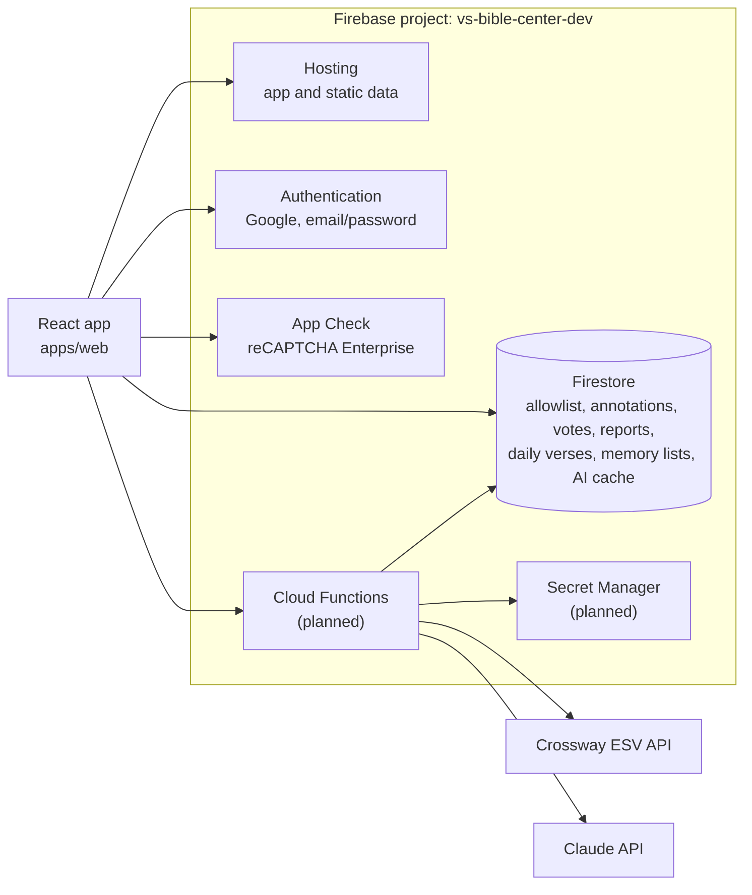

### Repository Layout

| Path | Holds |
| --- | --- |
| `apps/web` | The React app, with its env files, Vite and Playwright config, unit tests in `tests` and E2E specs in `e2e`. `@/` is an alias for its `src`. |
| `packages/core` | `@bible-center/core`: types and pure logic shared across the repo, with no browser or Firebase dependencies. |
| `scripts` | Emulator helpers and the deploy check. |
| `tests` | Tests that belong to the repo as a whole: security rules and scripts. Workspace unit tests live in each workspace's `tests` folder. |
| `functions` | Cloud Functions. Added with the first function. |

## Tech Stack

| Concern | Choice |
| --- | --- |
| UI | React, TypeScript, Mantine, SCSS |
| Routing | React Router |
| State | Zustand for app state, TanStack Query for fetched data |
| Backend | Firebase Authentication, Firestore, Hosting, App Check; Cloud Functions when needed |
| Build | Vite, npm workspaces |
| Tests | Vitest with React Testing Library, Playwright, Firebase emulators |
| Linting | ESLint with `@stylistic` and `react-hooks` |

TypeScript stays on 6.0 until `typescript-eslint` supports 7.

## Bible Text

### Translations

| Translation | Source | Delivery | Status |
| --- | --- | --- | --- |
| Berean Standard Bible (default) | [bereanbible.com/bsb.txt](https://bereanbible.com/bsb.txt), public domain (CC0) | Static files | Built |
| King James Version | [openbible.com/textfiles/kjv.txt](https://openbible.com/textfiles/kjv.txt), the Pure Cambridge Edition. Public domain in the US; see below | Static files | Built |
| English Standard Version | [Crossway API](https://api.esv.org/), non-commercial terms | Cloud Function | Waiting on Crossway |

NIV and NKJV are out of scope: both need paid or publisher licensing.

**KJV outside the US:** in the United Kingdom the KJV remains under a perpetual Crown patent, administered by Cambridge University Press, even though it is public domain elsewhere. The site is reachable from the UK, so review this before any wider launch. The source file brackets words its translators added; the build removes the brackets and keeps the words.

The default is BSB until a visitor picks another translation, which is remembered in that browser (`apps/web/src/stores/translation.ts`). For allowlisted users it is also saved to `users/{uid}`, so it follows them between devices (`apps/web/src/stores/useTranslationSync.ts`). ESV is not the default because its limits are shared by all users (60 requests a minute, 5,000 a day).

### ESV Rules

These come from Crossway's [API terms](https://api.esv.org/) and constrain the whole app, so check them again before relying on them:

- **ESV text never enters this public repository**, including fixtures, seeds and logs.
- The API key stays in Secret Manager and is only used from Cloud Functions.
- The site cannot charge for access, carry ads or sponsorships, or solicit donations.
- At most 500 verses or half a book, whichever is less, per request, per page and in any cache. Full-text indexing is therefore not possible.
- Each page using the text labels quotations "ESV", links to esv.org, and includes the copyright notice.
- Crossway can revoke access at any time, so the app must keep working without ESV.

### Reading Flow

Translations are interchangeable behind one interface. The reader never knows where text came from, and a new translation means a new provider rather than changes to the reader.

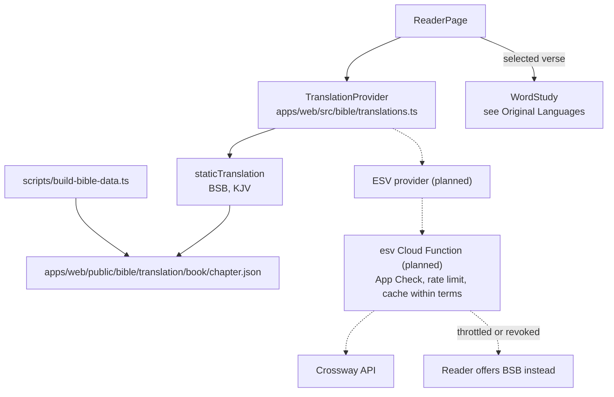

`scripts/build-bible-data.ts` downloads each source, checks that every chapter is present, and writes one JSON file per chapter. The output is committed, so a build needs no network and every change to the text is reviewable. It adds about 14 MB across 2,378 small files, marked as generated in `.gitattributes`. Run `npm run bible-data` only to change a source.

Source files run a psalm's title into verse 1 (`A Psalm of David. The LORD is my shepherd`), so the reader shows it that way rather than as the separate line in the mockup. A verse a translation omits, such as Matthew 17:21 in the BSB, is left out and the numbering shows the gap.

### Verse Identity

Annotations and votes are stored against a `VerseId`, never verse text, so they carry across translations and copyrighted text is not copied into Firestore. A `VerseId` is OpenBible's eight-digit `bbcccvvv` format: John 1:1 is `43001001`. See `packages/core/src/verseId.ts`.

Translations occasionally number verses differently. STEPBible's versification data (TVTMS) is the planned source for mapping them; the first non-matching translation will decide whether it is needed.

### Search

One search box handles references and remembered wording, at `/search?q=` (`apps/web/src/pages/SearchPage.tsx`). It searches the selected translation only. A search that is exactly a topic's name also links to that topic, through `findTopic`.

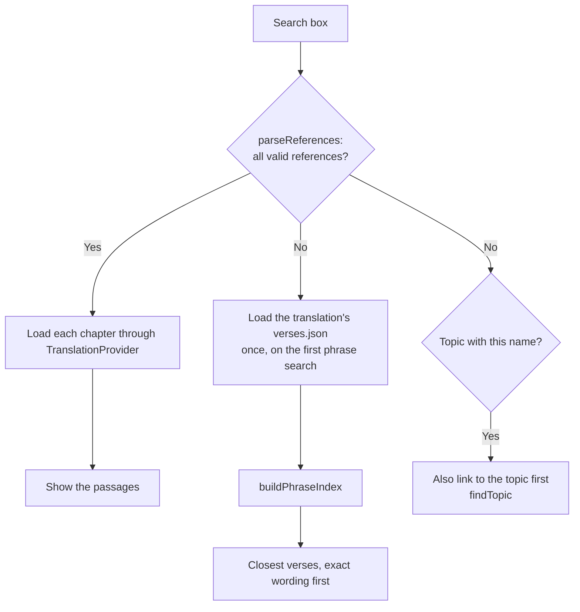

- **References** (`packages/core/src/references.ts`) accept book names and common abbreviations, ranges, whole chapters, and lists like `John 1:1; Acts 2:3-4; Revelation 22:13`. A search counts as references only if all of it is valid, so everything else falls through to phrase search.
- **Phrases** (`apps/web/src/bible/phraseSearch.ts`) use MiniSearch in the browser over `apps/web/public/bible/<translation>/verses.json`, about 4.5 MB per translation, or 1.3 MB compressed. Exact wording ranks first. Words of four or more letters tolerate typos and match by prefix, shorter ones must match exactly, and a verse needs at least half of the search's words.
- **Paraphrases** often work without AI. Against the real BSB, `I do not consider my life of any value nor as precious to myself` ranks Acts 20:24 first, and `the lord is my sheperd` finds Psalm 23:1 in the top two. Embeddings remain a possible later addition for wording that shares few words with any translation.
- **ESV** cannot be indexed because of the cache limit, so phrase search only covers translations offering `verses.json`.

Indexing takes about 300 ms on a laptop and happens once per translation, and most searches take under 40 ms. It runs on the main thread, so move it to a Web Worker if it proves noticeable on phones. Selecting a phrase result opens the verse in the reader, scrolled to and marked via `#v<verse>`.

## Annotations

Allowlisted users can highlight, bookmark and add notes to a verse or a range of verses within a chapter. Annotations store verse ids rather than text, so they appear in every translation and copy no scripture into Firestore.

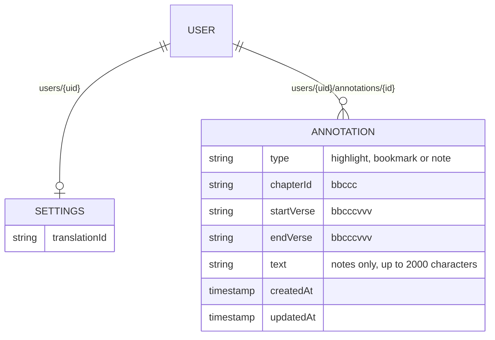

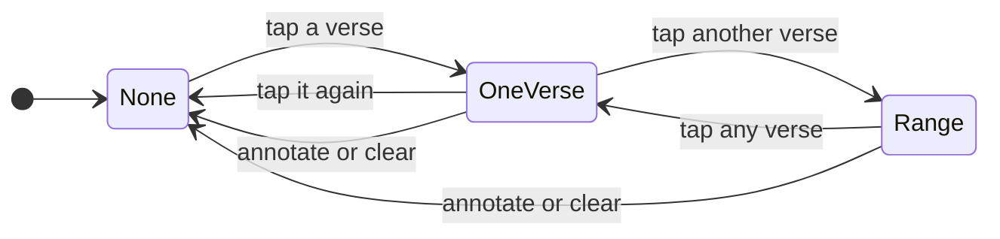

- **Selecting:** `selectVerse` in `packages/core/src/annotations.ts` implements this state diagram, for taps and for the verse number buttons, which are how keyboards reach it. Dragging across words to copy them does not select a verse. Anyone can select a verse, to see its [original words](#original-languages); only allowlisted users get the annotation tools. `ReaderPage` holds the selection, so the word panel beside the text can follow it.
- **Reading a chapter:** `useChapterAnnotations` queries by `chapterId`, the first five digits of a verse id. A range cannot cross chapters, since the reader shows one at a time.
- **Toggling:** if a selection overlaps any highlight or bookmark, the action removes every one it touches, even if it extends beyond the selection. Otherwise it adds one. Selecting over a note opens that note for editing.
- **Rules:** `firestore.rules` limits access to the owner on the allowlist, with a verified email. It also validates every field, requires server timestamps, keeps both ends of a range in the chapter, and only lets a note's text change. `tests/rules/users.spec.ts` covers this.
- **Loading:** actions stay disabled until a chapter's annotations load, since they cannot know what is already marked, and could add a duplicate instead of removing. Offline, the Firestore SDK answers queries from its empty cache instead of failing, so `listChapterAnnotations` treats a cached answer as a failure and retries with backoff. That way an outage shows an error rather than looking like having no annotations.
- **My verses:** `useAnnotationPages` reads 20 annotations at a time through `listAnnotationPage`, with Firestore doing the filtering and ordering, and "Show more" continues from the last one. Recently added orders by `createdAt`, and Bible order by `startVerse` then `endVerse`, since verse ids sort canonically as strings. Each ordering, alone and after a type filter, needs a composite index in `firestore.indexes.json`. The emulators do not check indexes, so a query added without one passes every test and fails only on the hosted project. Each entry loads its chapter in the selected translation through the same `chapterQuery` the reader uses, so a chapter is fetched once however many entries it has. The filter and order live in the URL (`?show=note&order=bible`), so they survive a trip to the reader and back. Removing asks for confirmation first, since a removed note's words cannot be recovered.
- **Keeping pages in step:** every annotation query key starts with `annotationQueryKeys.forUser`, and every change invalidates that prefix, so a change on either page refreshes the other's cached data.

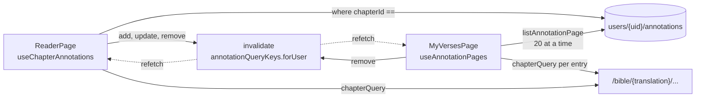

- **Limits:** the rules do not cap how many annotations a user can create, which is worth revisiting before the allowlist is removed.

## Verse of the Day

The home page shows one verse or short passage each day. An admin can choose it for any date, and any date without a choice gets an automatic pick, so the home page never needs attention.

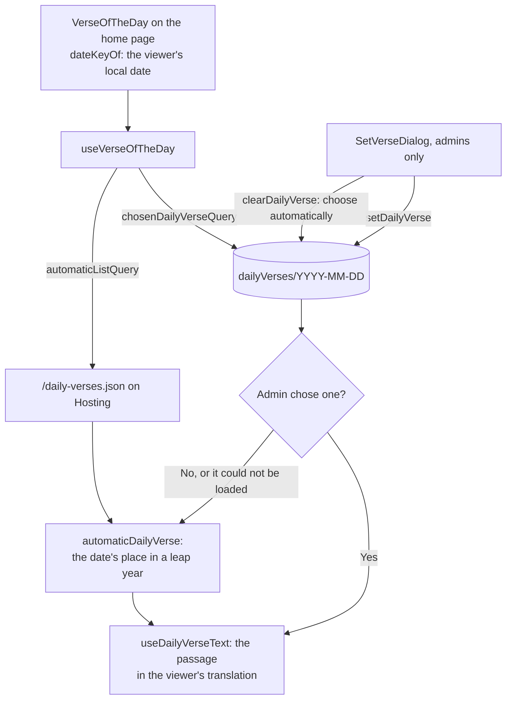

- **Choosing:** admins get "Set verse of the day" beside the verse, which opens `SetVerseDialog` on today's date. It loads what is set for the chosen date, then offers "Choose automatically" or a verse or passage, checked with `useReferenceSpan` (shared with adding a verse to a topic), and previews what visitors will see. Choosing automatically deletes the date's document. An admin is an allowlist entry with the `admin` role (see [Roles and Review](#roles-and-review)); `firestore.rules` lets only `isAdmin` write to `dailyVerses`, and `tests/rules/dailyVerses.spec.ts` covers it.
- **Dates:** each viewer sees the verse for their own date (`dateKeyOf`), so it changes at their midnight. `dayOfLeapYear` gives each month and day a fixed place from 0 to 365, so a date gets the same automatic verse every year, and only February 29 is skipped outside leap years. Everyone on the same date sees the same verse, and nothing runs on a schedule.
- **Storage:** a `VerseId` range, not text, so the verse appears in the viewer's translation. The list and documents hold no scripture. A document holds `startVerse`, `endVerse`, `setBy` and `setAt`, and a passage stays within one book.
- **Reading:** anyone can read a single date's document, but not list the collection. If it cannot be read, the automatic pick shows instead, so the home page always has a verse.

Building the automatic list, once:

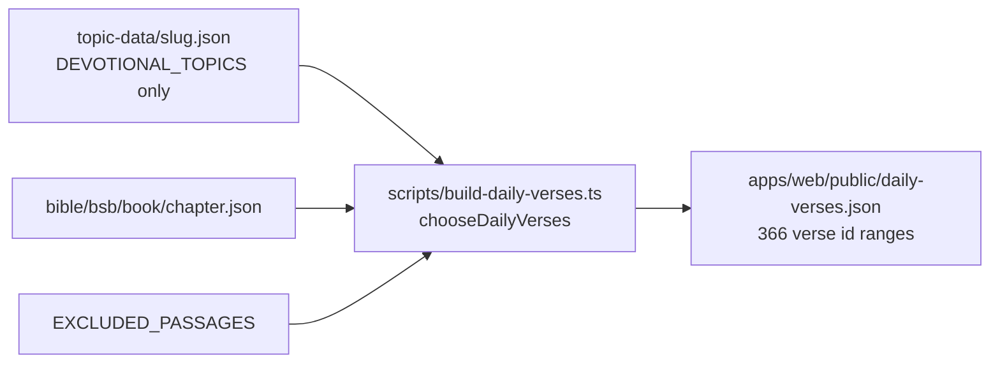

`npm run daily-verses` adds up each passage's OpenBible votes across about 50 encouraging topics, such as hope, comfort, strength and God's love. Counting every topic brought in verses on divorce and idolatry, since OpenBible's votes measure how well a verse fits a topic, not how encouraging it is. It keeps passages of up to 3 verses and 160 BSB characters that read as whole sentences, with no quotation left open. It leaves out a psalm's first verse, which often begins with the psalm's title, and anything in `EXCLUDED_PASSAGES`. Of overlapping passages, it keeps the most-voted. The top 366 are shuffled with a fixed seed, so the best-loved verses are spread across the year and a rebuild from the same data gives the same order. The list is committed and needs a person's review before launch; see [Open Items](#open-items).

## Topic Search

"What does the Bible say about ___?" ranks verses using three sources: Bible Center upvotes, OpenBible's votes as a starting point, and AI suggestions to fill gaps.

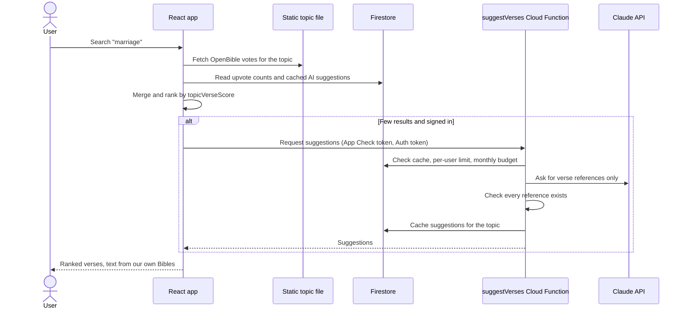

### Ranking

Implemented in `packages/core/src/topicScore.ts`:

```text
seedScore = 20 × log(1 + openBibleVotes) / log(1 + topicMaxOpenBibleVotes)
score     = seedScore + upvotes
```

OpenBible's counts are too large to add directly: Genesis 2:24 has 2,953 votes for "marriage", so Bible Center's votes could never change the order. The log scale keeps OpenBible's order but compresses each topic to a 0-20 starting score. For "marriage", the top verse starts at 20 and a verse with 14 votes starts at about 7.

Each upvote adds 1, so 21 upvotes put a verse with no OpenBible votes ahead of that topic's top verse. As the community grows, its votes outweigh the seed without any migration. To change how quickly that happens, change `MAX_SEED_SCORE`.

The app shows OpenBible and Bible Center counts separately rather than the combined score.

### Voting

- Upvotes only. Users can remove their own upvote, and can report an entry that does not belong.
- Signed-in users can upvote an existing verse or associate a verse with a topic.
- One vote per user for each verse and topic, enforced by the document path and security rules.
- Counts are checked by the security rules rather than kept by a Cloud Function. `upvoteVerse` and `removeUpvote` in `apps/web/src/firebase/topics.ts` change a vote and its count in one transaction, and the rules use `existsAfter` and `getAfter` to accept a count change only when that user's vote is created (+1) or deleted (-1) in the same write, and a vote only when its count moves with it. Adding a verse to a topic creates its count at 1 alongside the adder's vote. A transaction retries when someone else votes at the same moment, so no vote is lost. `tests/rules/topics.spec.ts` tries each way of changing a count without a vote.
- Anyone can read the counts. A user's own votes are found with one collection-group query on `uid` and `topic`, and nobody else can read them.
- Reports go to `reports` for review, with a reason from `REPORT_REASONS` and up to 500 characters of details. They do not change the ranking, so they cannot be used to bury verses. Only reviewers can read them; see [Roles and Review](#roles-and-review).
- Topic names are normalized (trimmed, lowercased, single spaces). Adding the first verse to a topic OpenBible does not have starts it, as a `topics/{slug}` document with `status: 'pending'`. It works by its link, but is not listed or linked from search until a reviewer approves it. A rejected topic's page says it is not available, and nobody can add verses to it.
- A verse a reviewer removed from a topic has a `topics/{slug}/removed/{key}` document. `rankTopicVerses` leaves it out, which hides OpenBible's verses too, and nobody can add it back.
- A verse someone adds starts with one vote, so it usually ranks low. The page grows to include it and scrolls to it, so the person sees it was added.

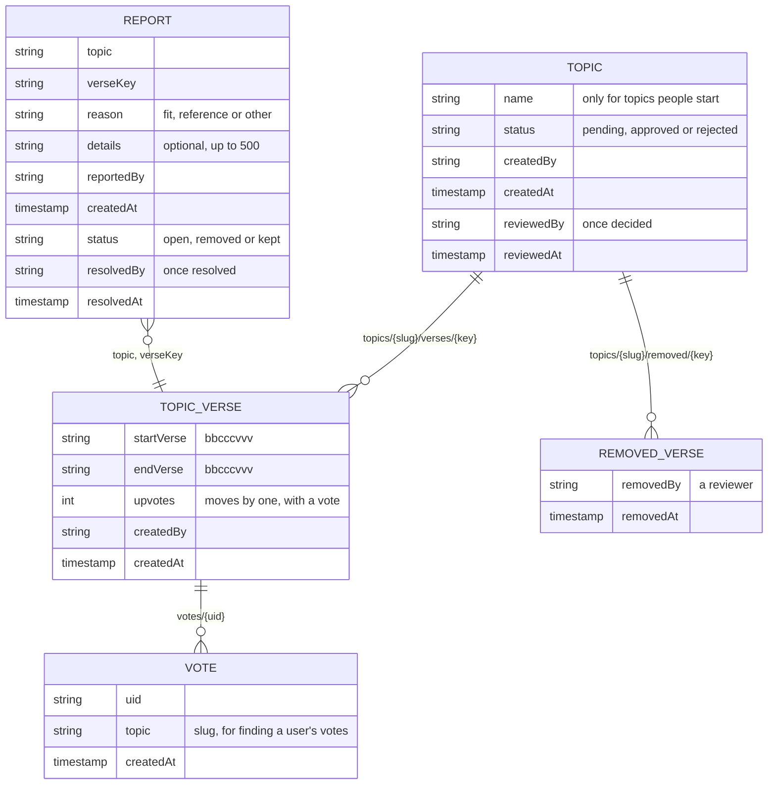

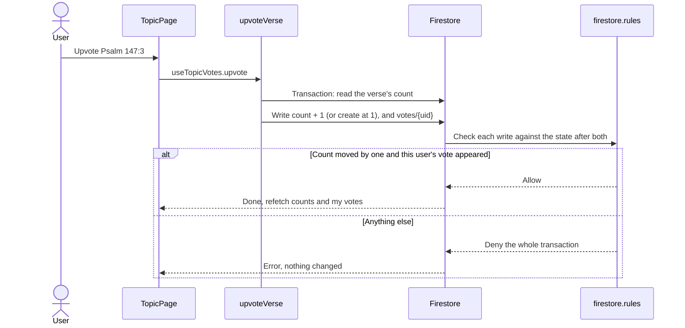

### OpenBible Data

[OpenBible.info's topic data](https://www.openbible.info/topics/) is licensed CC BY, so the app must credit it with a link wherever it is shown. The [vote file](https://a.openbible.info/data/topic-votes.txt) is refreshed weekly upstream and contains only topics, verse references and vote counts, with no scripture text. As of November 2026 it has about 470,000 rows across 6,751 topics. Each row may be a range (`Topic`, `Start Verse ID`, `End Verse ID`, `Votes`).

`scripts/build-topic-data.ts` (`npm run topic-data`) splits it into one static JSON file per topic on Hosting, so reading a topic costs no Firestore reads. Names are normalized (trimmed, lowercased, single spaces), and spellings that share a slug, such as "self control" and "self-control", become one topic named by the more-voted spelling, keeping a passage's higher count where both list it. That leaves 6,739 topics. Rows naming a verse that does not exist are dropped. `_index.json` lists every name, for the Topics page and for spotting a search that names a topic, and `topicNamesQuery` adds the approved topics people started from Firestore. If those cannot be loaded, OpenBible's topics still show; no slug starts with an underscore, so it never collides with a topic. The output is committed, like the Bible text: about 13 MB across 6,740 small files, marked as generated in `.gitattributes`. Refreshing means rerunning the script and committing the result. Bible Center votes are unaffected, since they are keyed by topic slug and verse ids.

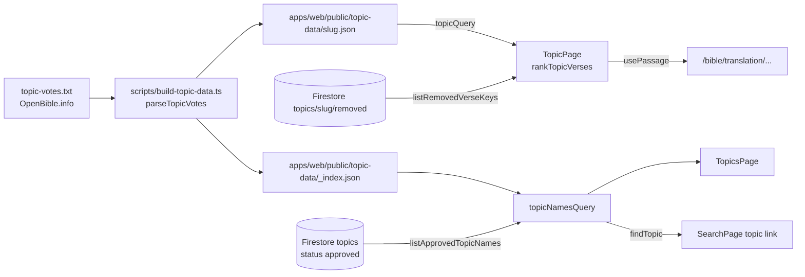

Hosting and the dev server answer a missing file with the app's HTML page rather than a 404, so `fetchTopicData` treats any answer that is not JSON as "no such topic". A topic OpenBible does not have shows as empty, ready for someone to add the first verse.

### AI Suggestions

Claude Opus 5.5 fills gaps only. OpenBible already covers the common topics.

- Only signed-in users can trigger a lookup, with a per-user limit and a hard **$10 monthly** cap.
- Each topic is looked up once. The cached result is shared with everyone.
- The model returns references only. Every reference is checked, and verse text always comes from our own Bibles.
- Suggestions are labeled as AI-suggested, start with a low score, and appear only for topics with few results. Upvotes raise them like any other verse.

Estimated cost at the time of the decision is about $0.03 per new topic ($4 / $20 per million input / output tokens, about 500 input and 1,500 output tokens). Replace this with measured numbers once it runs.

## Memorization

Anyone can practice a verse or passage by heart at `/memorize/practice?passage=Psalm 23:1-2`, reached from the Memorize page, the reader's verse tools, or beside the verse of the day. Allowlisted users also keep a memory list.

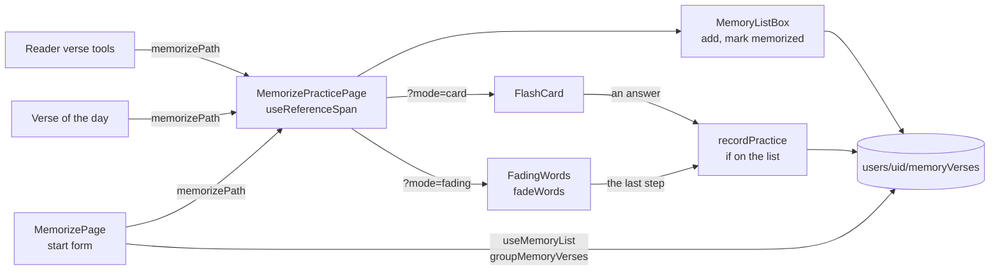

- **Flash card:** the reference, then the verse when turned over, and "Did you have it?" with "Not yet" and "I knew it". A count of answers lasts for the visit only.
- **Fading words:** `fadeWords` in `packages/core/src/memorize.ts` gives five steps: every word, one in three hidden, two in three, first letters only, then none. Punctuation stays in view, and selecting a blank shows that word.
- **The passage** is any one reference, checked with `useReferenceSpan`, the same check as adding a verse to a topic, and shown in the selected translation. A psalm's first verse includes its title, as the source text runs them together.
- **The memory list:** each entry is learning or memorized. A memorized verse is due for review `REVIEW_AFTER_DAYS` (7) after it was last practiced, and `groupMemoryVerses` lists due verses first, then learning, then memorized. Answering the flash card or reaching the last fading step updates `practicedAt` for a verse on the list, so practicing a due verse moves it back among the memorized ones. There is no spaced-repetition schedule beyond this.
- **Rules:** as with annotations, only the owner on the allowlist with a verified email can read or change their list. An entry is keyed like a topic's verse, starts as learning, and only its `status` and `practicedAt` can change, with `practicedAt` set by the server. `tests/rules/memoryVerses.spec.ts` covers this. Like annotations, the list is not capped in size.

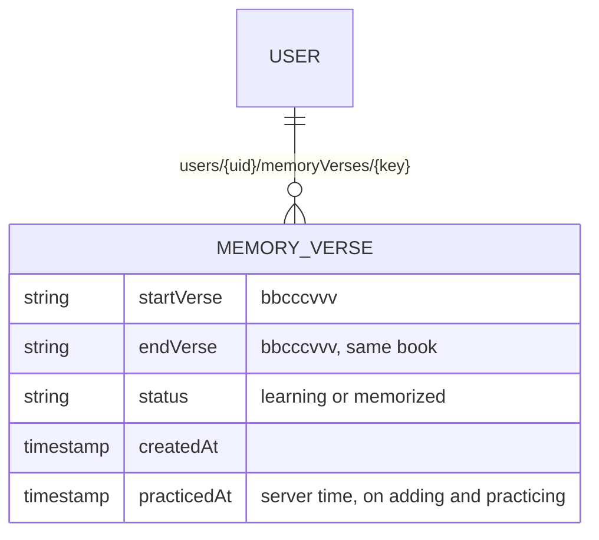

## Original Languages

| Data | Source | License |
| --- | --- | --- |
| Hebrew and Greek tagged text (TAHOT, TAGNT) | [STEPBible](https://github.com/STEPBible/STEPBible-Data), from Tyndale House | CC BY 4.0. Credit STEP Bible and Tyndale House with a link to [STEPBible.github.io/STEPBible-Data](https://stepbible.github.io/STEPBible-Data/), and note any changes |
| Brief lexicons (TBESH, TBESG) and morphology expansions (TEHMC, TEGMC) | STEPBible | CC BY 4.0 |

Anyone can select a verse in the reader, signed in or not, to see its words in the original language: Hebrew for the Old Testament, with Daniel's and Ezra's Aramaic labeled as Aramaic, and Greek for the New. Selecting a word shows its transliteration, English, dictionary form, main senses, grammar and Strong's number, which links to STEP Bible. On desktop the panel sits beside the text and follows the verse tapped last; on phones a "Hebrew words" or "Greek words" button among the verse's tools opens it in a sheet.

Building the data, once:

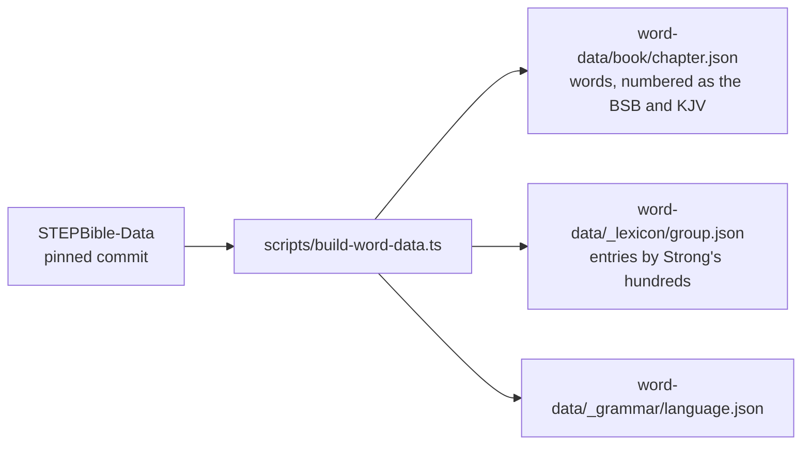

Reading it, for the selected verse:

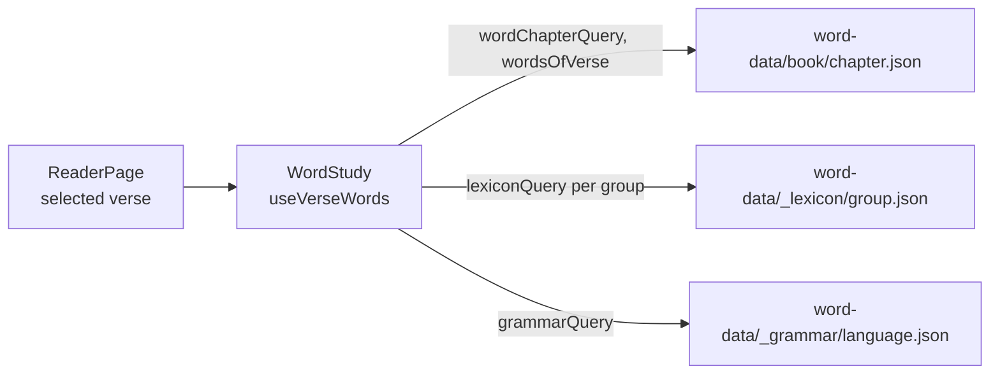

- **Building:** `scripts/build-word-data.ts` (`npm run word-data`) downloads a pinned commit of STEPBible-Data and writes about 28 MB across 1,346 files, committed and marked as generated in `.gitattributes`. A chapter's file holds its words; dictionary entries are shared in 155 files by Strong's number in hundreds (`lexiconGroup`), so a common word is stored once; and one file per language describes the grammar codes. To update, change `STEPBIBLE_COMMIT` and rerun.
- **Changes to STEPBible's data,** which its license asks to be noted: Hebrew cantillation marks and STEPBible's prefix and suffix dividers are removed, vowels kept; lexicon definitions are shortened to up to three main senses; grammar codes are spelled out in plain English; and words are renumbered to the BSB's and KJV's verses, as below.
- **Which Greek:** the panel follows the translation being read. The BSB translates the Nestle-Aland text and the KJV the Textus Receptus, so a word only one has is marked with that translation. Where they read differently at the same place, as in John 1:18 ("God" or "Son"), the KJV's word comes from STEPBible's meaning variants. The BSB also translates Mark 16:9-20 and John 7:53-8:11, which Nestle-Aland brackets.
- **Numbering:** STEPBible numbers verses by the NRSV. A Psalm's title, its verse 0, joins verse 1, as the BSB and KJV print it. In 52 places the KJV puts Greek words in the next or previous verse; each word records the KJV's verse, and `BSB_FOLLOWS_KJV` lists the 20 where the BSB does the same, found by comparing its verses with the words' English. At Revelation 12:18 both start chapter 13. The script refuses to write anything if a verse of either translation has no words, or words land in a verse it does not have.
- **Fonts:** Noto Serif Hebrew for Hebrew and Aramaic, read right to left, and Gentium Book Plus for Greek.
- **Not yet:** selecting an English word to find its source word needs tagging data for each translation; BSB's translation tables are the candidate, and their contents have yet to be checked.

## Authentication and Access

Anyone can read the Bible without an account. Signing in unlocks annotations and voting, and for now is limited to an allowlist in `allowedUsers/{lowercase email}`, which admins manage on the People page. Each entry also holds the person's role; see [Roles and Review](#roles-and-review).

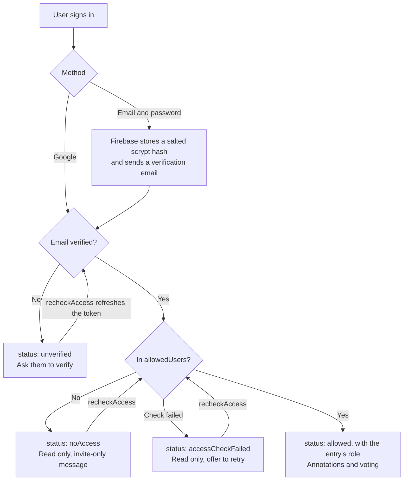

`apps/web/src/stores/auth.ts` holds this status and the role, and `SignInPage` shows the panel for the status. The status only shapes the interface; the security rules enforce access.

**The verified-email check is what makes the allowlist safe.** Anyone can register a password account using someone else's address, so an unverified email proves nothing. `firestore.rules` requires `email_verified` before accepting one, and `tests/rules/allowedUsers.spec.ts` covers this.

Firebase handles the password storage. The app never sees or stores a password. Firebase keeps one account per email by default, and a Google sign-in takes over an unverified password account with the same address, removing the password.

## Roles and Review

Everyone on the allowlist has a role, stored as `role` on their `allowedUsers/{lowercase email}` entry. An entry with no role, as older ones have, is a member. Each role can do everything the ones before it can:

| Role | Can also |
| --- | --- |
| Member | Highlight, bookmark, take notes, vote, add verses, start topics and report verses |
| Reviewer | Remove reported verses or keep them, and approve or reject topics people start, on the Review page (`/review`) |
| Admin | Add people, change their roles and remove them, on the People page (`/people`), and set the [verse of the day](#verse-of-the-day) from the home page |

- **Roles in code:** `ROLES`, `canReview` and `isAdmin` in `packages/core/src/roles.ts`. `getAccess` in `apps/web/src/firebase/access.ts` reads the role with the allowlist check, and the auth store keeps it. `RoleGate` shows a page only to its roles and `useAccountLinks` lists the pages each role can open. These only shape the interface; `myRole`, `isReviewer` and `isAdmin` in `firestore.rules` enforce it.
- **Managing people:** only admins can read or change the allowlist, and never their own entry, so there is always an admin and nobody can promote themselves. Each write records `updatedBy` and `updatedAt`. Adding someone already on it is refused rather than changing their role. The first admin is set in the console; see [DEPLOYMENT.md](docs/DEPLOYMENT.md#allowlist-and-roles). Removing someone keeps their annotations and votes, which are keyed by their account.
- **The queue:** `useReviewQueue` loads the open reports and pending topics, oldest first, which needs the two `status, createdAt` indexes. `groupReports` gathers reports by topic and verse, so a reviewer decides once for each. The account menu shows how many are waiting. A decision stays on the page, with its outcome, until the queue next loads.
- **Resolving reports:** `resolveReports` closes every report in a group in one transaction. Removing also creates `topics/{slug}/removed/{key}` in the same write, and the rules only accept a report closed as removed when that document exists afterwards.
- **Deciding topics:** `decideTopic` sets a pending topic to approved or rejected, once. Approved topics join the Topics page and search links; rejected ones are hidden and closed to new verses.

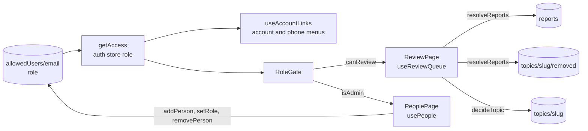

`firestore.rules` checks every write in this diagram with `isReviewer` or `isAdmin`.

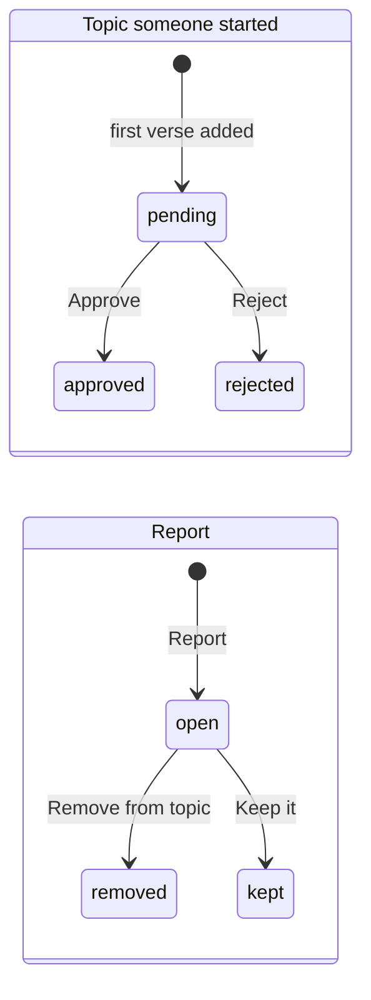

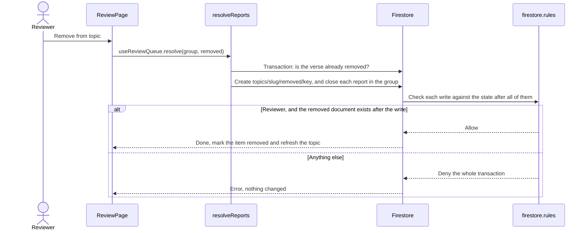

## Security

This repository and the app are public, so assume hostile use.

- **Firestore** denies everything unless a collection opts in. Rules validate each field and tests cover them.
- **App Check** starts before Auth and Firestore make requests, and stays off against the emulators. See [DEPLOYMENT.md](docs/DEPLOYMENT.md#app-check-setup).
- **Deploys** are refused without a site key, or with a debug token or emulator flag (`scripts/check-firebase-config.ts`).
- **Secrets** live in Secret Manager. `VITE_` variables end up in the public bundle, so they never hold secrets.
- **Paid or limited services** are reached only through Cloud Functions with App Check, sign-in where appropriate, per-user limits, and a budget cap.
- **Hosting** sends `nosniff`, `X-Frame-Options` and `Referrer-Policy` headers. A Content Security Policy is still to be added, once the app's external origins are settled.

## Environments and Delivery

```mermaid
flowchart LR
  dev["npm run dev"] -- ".env.development" --> emulators["Local emulators<br/>demo-bible-center"]
  e2e["npm run test:e2e"] -- ".env.development" --> emulators
  rules["npm run test:emulator"] --> emulators
  ci["GitHub Actions ci.yml<br/>pull requests, pushes to main"] --> e2e
  ci --> rules
  staging["npm run dev:staging"] -- ".env.staging<br/>.env.staging.local" --> project["vs-bible-center-dev"]
  deploy["npm run deploy"] --> check["check-firebase-config.ts"]
  check --> build["vite build --mode staging"]
  build --> project
  project --> site["vs-bible-center-dev.web.app"]
```

Staging is production until a separate production project exists. Details are in [DEVELOPMENT.md](docs/DEVELOPMENT.md#environment-files) and [DEPLOYMENT.md](docs/DEPLOYMENT.md).

## Licensing

The code is under [PolyForm Noncommercial 1.0.0](LICENSE): anyone may use, change and share it for noncommercial purposes, but not sell it or charge for it. It is source-available rather than OSI open source, and it does not require people to publish their changes.

Bible text and datasets keep their own licenses, and the app must credit OpenBible and STEP Bible. The word panel credits STEP Bible and Tyndale House with a link to STEPBible's data, and [Original Languages](#original-languages) notes the changes made to it.

## Diagram Index

Before finishing a change, check whether it touches a source below, and update that diagram in the same change. "Planned" diagrams show the approved design; check them against the code when building that feature.

| Diagram | Sources | State |
| --- | --- | --- |
| [System Overview](#system-overview) | `firebase.json`, `apps/web/src/firebase/`, `functions/` | Partly built |
| [Reading Flow](#reading-flow) | `apps/web/src/pages/ReaderPage.tsx`, `apps/web/src/bible/translations.ts`, `scripts/build-bible-data.ts` | Built, ESV planned |
| [Search](#search) | `apps/web/src/pages/SearchPage.tsx`, `packages/core/src/references.ts`, `apps/web/src/bible/phraseSearch.ts`, `scripts/build-bible-data.ts` | Built |
| [Annotations](#annotations), data model, selection and pages | `firestore.rules`, `packages/core/src/annotations.ts`, `apps/web/src/firebase/annotations.ts`, `apps/web/src/firebase/settings.ts`, `firestore.indexes.json`, `apps/web/src/components/annotationQueryKeys.ts`, `apps/web/src/components/myVerses/`, `apps/web/src/pages/MyVersesPage.tsx` | Built |
| [Memorization](#memorization), flow and data model | `packages/core/src/memorize.ts`, `apps/web/src/firebase/memoryVerses.ts`, `apps/web/src/components/memorize/`, `apps/web/src/pages/MemorizePage.tsx`, `apps/web/src/pages/MemorizePracticePage.tsx`, `firestore.rules` | Built |
| [Verse of the Day](#verse-of-the-day), choosing and building the list | `packages/core/src/dailyVerses.ts`, `apps/web/src/firebase/dailyVerses.ts`, `apps/web/src/components/verseOfTheDay/`, `scripts/build-daily-verses.ts`, `firestore.rules` | Built |
| [Topic Search](#topic-search) | `packages/core/src/topicScore.ts`, `packages/core/src/topics.ts`, `apps/web/src/pages/TopicPage.tsx`, `suggestVerses` | Built, AI suggestions planned |
| [Voting](#voting), data model and upvoting | `firestore.rules`, `firestore.indexes.json`, `apps/web/src/firebase/topics.ts`, `apps/web/src/components/topics/` | Built |
| [Original Languages](#original-languages) | `scripts/build-word-data.ts`, `packages/core/src/words.ts`, `apps/web/src/bible/wordData.ts`, `apps/web/src/components/reader/WordStudy.tsx`, `apps/web/src/components/reader/useVerseWords.ts`, `apps/web/src/pages/ReaderPage.tsx` | Built |
| [Roles and Review](#roles-and-review), structure, statuses and resolving a report | `packages/core/src/roles.ts`, `packages/core/src/review.ts`, `apps/web/src/firebase/review.ts`, `apps/web/src/firebase/people.ts`, `apps/web/src/components/review/`, `apps/web/src/components/people/`, `apps/web/src/components/RoleGate.tsx`, `apps/web/src/components/useAccountLinks.ts`, `apps/web/src/pages/ReviewPage.tsx`, `apps/web/src/pages/PeoplePage.tsx`, `firestore.rules` | Built |
| [OpenBible Data](#openbible-data) | `scripts/build-topic-data.ts`, `apps/web/src/topics/topicData.ts`, `apps/web/src/pages/TopicPage.tsx`, `apps/web/src/pages/TopicsPage.tsx`, `apps/web/src/pages/SearchPage.tsx` | Built |
| [Authentication and Access](#authentication-and-access) | `firestore.rules`, `apps/web/src/stores/auth.ts`, `apps/web/src/firebase/access.ts`, `apps/web/src/pages/SignInPage.tsx` | Built |
| [Environments and Delivery](#environments-and-delivery) | `package.json`, `apps/web/.env.*`, `firebase.json`, `scripts/`, `.github/workflows/ci.yml` | Built |
