# Architecture

How Bible Center is designed, why, and where the work stands. This is the main handoff document between sessions.

## Project Status

**V1 is complete.** Next come the features planned for after it; see [Next Steps](#next-steps).

| Area | Status |
| --- | --- |
| Monorepo, tooling, tests, env files, Firebase and App Check wiring, deploy check | Done. App Check is enforced for Firestore and Authentication |
| GitHub Actions CI (`.github/workflows/ci.yml`) | Built. Runs on pull requests and pushes to `main` |
| Firestore rules and indexes: default deny, verified accounts, roles, blocked accounts, user settings, annotations, topics, daily verses, memory lists | Built and deployed |
| Design mockups | Approved |
| Two-step sign-in for staff, and refusing temporary emails | Built and deployed to staging; see [Two-Step Sign-In](#two-step-sign-in) |
| Production environment | Set up in the repo: `vs-bible-center-prod`, served at `vs-bible-center.web.app`, with its own config, service accounts and release check. The first deploy waits on the owner; see [Environments and Delivery](#environments-and-delivery) |
| Sign-in and registration | Built, and open to anyone with a verified email. Google sign-in and registering by email are confirmed on the hosted site |
| App layout: app bar, thumb index, phone menu, footer, light and dark mode | Built |
| Home page | Built, with Verse of the Day, search and the common topics |
| Verse of the Day | Built: the automatic list, the admin dialog, and `dailyVerses` rules. The owner approved the list on November 10, 2026 |
| Site icon (tab and bookmark) | Built |
| Reader (BSB, KJV), translation switching | Built |
| Reference and phrase search | Built |
| Annotations: highlights, bookmarks, notes, on verses or ranges | Built |
| Translation choice saved to the account | Built |
| My verses page | Built |
| About dialog | Built: a shorter version of the README with data credits, from the footer and the phone menu |
| Privacy policy and account deletion | Built: `/privacy`, and deleting an account with the `deleteAccount` function; see [Account Deletion](#account-deletion) |
| Topic search, voting, reports | Built: topic pages, the Topics page, voting ranked by `topicVerseScore` from accounts at least a week old, adding verses, starting topics and reports |
| Admins and reviewers | Built: roles in `roles/{email}`, the People page for admins, the Review page for reported verses and new topics, and blocking accounts; see [Blocking](#blocking) |
| Hebrew/Greek study | Built: the word panel beside the reader, or in a sheet on phones, from STEPBible data |
| Scripture memorization | Built: flash cards, fading words, and the memory list; see [Memorization](#memorization) |
| AI topic suggestions | After V1 |
| ESV | After V1, once Crossway approves the API key |
| Boards, plugins, paraphrase search (embeddings) | After V1 |

### Current State

Last updated November 16, 2026.

- **Repository:** [Valiance-Studios/bible-center](https://github.com/Valiance-Studios/bible-center) is public. Everything in V1 is merged. Check what has merged before starting new work.
- **Hosted projects:** staging is `vs-bible-center-dev`, at [vs-bible-center-dev.web.app](https://vs-bible-center-dev.web.app). Production is `vs-bible-center-prod`, at [vs-bible-center.web.app](https://vs-bible-center.web.app), not yet deployed. The owner deploys both; see [DEPLOYMENT.md](docs/DEPLOYMENT.md), which also covers the API key's restrictions and moving the debug token aside before deploying Hosting.
- **Set up in production so far:** Firebase, the `vs-bible-center` Hosting site, Firestore `(default)` in `nam5`, Google and email/password sign-in, Identity Platform with the password policy, reCAPTCHA in audit mode, two-step sign-in and email enumeration protection, authorized domains (without `localhost`), the billing budget and both alerts, the Cloud Functions APIs, the `sa-bc-*-prod` service accounts and the build role, the App Check reCAPTCHA key (in `apps/web/.env.production`), the API key's restrictions and the web app. The rest of [Setting Up a Project](docs/DEPLOYMENT.md#setting-up-a-project) waits on the owner.
- **Set up in staging:** billing, Firestore `(default)` in `nam5`, Hosting, the web app, the reCAPTCHA Enterprise key, App Check registration, Google and email/password sign-in, and the APIs for Cloud Functions, Cloud Run, Cloud Build, Artifact Registry, Eventarc and Secret Manager. The owner's account is the first admin, set in the console as [DEPLOYMENT.md](docs/DEPLOYMENT.md#roles) describes.

### Next Steps

V1 is complete. Build what comes after it one branch at a time, from `main` or from the latest unmerged branch, in this order:

1. **AI topic suggestions:** the first function with a secret; see [AI Suggestions](#ai-suggestions).
2. **ESV:** once Crossway approves the key; see [ESV Rules](#esv-rules).
3. **Boards;** see [Scope](#scope).

Later, if there is demand: plugins, and embeddings for search by meaning.

### Open Items

Waiting on the owner:

- Crossway's decision on the ESV API key. Once approved, the owner adds the key to Secret Manager and shares the secret's name.
- Choose whether to keep the KJV source, the Pure Cambridge Edition from OpenBible, or swap to one with a clearer license statement. Review the UK Crown patent before a wider launch; see [Translations](#translations).
- Finish setting up production by [Setting Up a Project](docs/DEPLOYMENT.md#setting-up-a-project), then do its first release.
- Switch reCAPTCHA for email and password from audit to enforce in each project, once a week of its scores looks right (production started November 16, 2026); see [Identity Platform](docs/DEPLOYMENT.md#identity-platform).
- Try the password reset email on the hosted site. Registering by email, with its confirmation email, works there; password reset has only run against the emulators.

To do when reached:

- An Anthropic API key, a Secret Manager entry for it, and a $10 monthly spend limit are needed at the AI step.
- App Check is enforced for Firestore and Authentication in the console, and by each callable function's `enforceAppCheck` option. Enforce each new console service once its requests show as verified; see [DEPLOYMENT.md](docs/DEPLOYMENT.md#enforcement).
- The main bundle is about 1.2 MB because every page loads Firebase and Mantine. Signed-out reading should not need Firestore or Auth up front, so split them out.
- Add a Content Security Policy once the app's external origins are settled.
- Check the first phrase search on a real phone, and move indexing to a Web Worker if it is slow.
- reCAPTCHA for email sign-in and sign-up is in audit mode. Once its scores show real people pass, switch it to enforce; see [DEPLOYMENT.md](docs/DEPLOYMENT.md#identity-platform).
- Topics created by users start pending: they work by link but are not listed or linked from search until a reviewer approves them on the Review page. Topic names are the only public free text; see [What Is Public](#what-is-public).
- A review decision cannot be undone in the app. A removed verse or a rejected topic can be restored by deleting its `removed` document or setting the topic back to `pending` in the console.
- The `allowedUsers` collection from before sign-up opened is no longer read or writable by anyone, and can be deleted in the console.
- Common topics are a fixed list for now. Later they could follow what people search for, which changes through the year (such as "resurrection" around Easter).

### Resuming in a New Session

Start with "Starting a Session" in `CLAUDE.md`, then the [Mockups](#mockups) section. Everything needed is in this repository, except the mockups, which live on the canvas linked there, and two local items: `apps/web/.env.staging.local`, which holds this machine's App Check debug token, and the owner's Google Cloud login. See [DEVELOPMENT.md](docs/DEVELOPMENT.md) to set up a new machine.

## Mockups

[**Open the mockups**](https://claude.ai/artifact/D12B3TA5t5Hahvs9wXbL9v). The canvas is private to its owner until shared from its Share menu, so this link only opens for people given access.

| Artboard | Shows |
| --- | --- |
| `Main.dc.html` | Home with Verse of the Day, search and topics |
| `Reader.dc.html` | Reader with annotations and the Hebrew word panel |
| `ReaderGreek.dc.html` | The reader's Greek word panel, with the dictionary form, which the Hebrew panel shows too |
| `ReaderRange.dc.html` | The word panel with several verses selected, stepping through them with arrows |
| `ReaderDark.dc.html` | The reader in dark mode |
| `Topic.dc.html` | Topic results. Upvoting re-ranks live with the real formula |
| `TopicAi.dc.html` | A topic with few results, showing AI suggestions |
| `SetVerse.dc.html` | The admin dialog for Verse of the Day |
| `SignIn.dc.html` | Sign in, register and verify email, from before sign-up opened; `SignInOpen.dc.html` replaces it |
| `PhoneHome.dc.html` | Home on a phone |
| `PhoneMenu.dc.html` | The phone menu, with sections and their books |
| `PhoneReader.dc.html` | The reader and word panel on a phone |
| `SearchReferences.dc.html` | Search results for references |
| `SearchPhrase.dc.html` | Search results for a paraphrase, an exact phrase, and a word that is also a topic |
| `SearchEmpty.dc.html` | A search with no matches |
| `PhoneSearch.dc.html` | Search results on a phone |
| `MyVerses.dc.html` | All of a user's highlights, bookmarks and notes, with filters and ordering |
| `MyVersesEmpty.dc.html` | My verses with nothing saved yet |
| `PhoneMyVerses.dc.html` | My verses on a phone |
| `Topics.dc.html` | All topics: find one, common topics, and A to Z |
| `TopicAddVerse.dc.html` | Adding a verse to a topic, with a preview and the problems it can report |
| `TopicReport.dc.html` | Reporting a verse on a topic |
| `TopicEmpty.dc.html` | A topic nobody has added a verse to yet |
| `PhoneTopic.dc.html` | A topic on a phone, signed out |
| `Review.dc.html` | Reviewers remove or keep reported verses, and approve or reject new topics |
| `People.dc.html` | Admins add people, set their roles and remove access, from before sign-up opened; `PeopleOpen.dc.html` replaces it |
| `AccountMenuRoles.dc.html` | The account menu for an admin, with Review and People |
| `PhoneReview.dc.html` | Review on a phone |
| `Memorize.dc.html` | Memorize: start a verse, and the memory list in its sections, or empty, or signed out |
| `MemorizeCard.dc.html` | Practicing with a flash card, and the memory list box |
| `MemorizeFading.dc.html` | Practicing with fading words, in five steps |
| `PhoneMemorize.dc.html` | A flash card on a phone |
| `About.dc.html` | The About dialog, from the home page's footer |
| `SignInOpen.dc.html` | Sign in and register once sign-up is open to everyone, with the age and privacy line |
| `TopicNewAccount.dc.html` | A topic for an account too new to vote, saying when it can |
| `Limits.dc.html` | The messages when a cooldown or a limit on what one account keeps is reached |
| `PeopleOpen.dc.html` | Admins give roles, and block and unblock accounts, once sign-up is open |
| `ReviewBlock.dc.html` | Admins block the account behind a reported verse, a report or a new topic |
| `Privacy.dc.html` | The privacy policy |
| `DeleteAccount.dc.html` | Deleting your account from the account menu |
| `BlockedAccount.dc.html` | What a blocked account sees wherever it would save |
| `TwoStepSetup.dc.html` | Staff set up two-step sign-in from the Review or People page |
| `TwoStepSignIn.dc.html` | The authenticator app's code at sign-in |
| `SignUpRefused.dc.html` | A sign-up from a temporary email service refused |

The canvas is the source of truth for the design. To work from it in a new session, read `project/canvas.json` and any `project/<artboard>` from that URL with the Artifact tool. The design language is in [UI.md](docs/UI.md#design-language).

Scripture in the mockups is the public-domain BSB and OpenBible counts are real. Bible Center upvotes, dates and accounts are samples. The Hebrew word entries are illustrative; the Greek ones are from STEPBible's data, with meanings shortened by hand.

## Scope

Bible Center is a free, public, one-stop Bible resource. The [README](README.md) is the public introduction.

**V1**

- A Verse of the Day on the home page, chosen by an admin or automatically.
- Read the Bible and switch between translations.
- Search by reference (`John 1:1`, `John 1:1-5`, `John 1:1; Acts 2:3-4; Revelation 22:13`) or by a remembered phrase.
- Signed-in users can highlight, bookmark and otherwise annotate verses.
- See the Hebrew and Greek behind the English.
- "What does the Bible say about ___?" topic search, ranked by community upvotes.
- Google sign-in and email/password registration, open to anyone with a verified email.
- Memorize scripture with flash cards and fading words, and keep a memory list; see [Memorization](#memorization).
- An About dialog with the data credits.

**After V1: AI topic suggestions and the ESV.** Both are designed below, and wait until V1 is done.

**After V1: boards.** Signed-in users create titled, infinitely scrolling boards holding photos, text boxes, embedded videos, links to other boards, and titled photo carousels whose navigation wraps in both directions. Items can be tagged and searched. Selecting a result jumps to the item, and for a photo in a carousel, makes that photo active.

**Later, if there is demand: plugins.** Translations and search sit behind interfaces so a plugin system could be added. None is built now.

## System Overview

Public-domain Bible text and OpenBible data are static files, so reading costs almost nothing and needs no backend. Firestore holds only what users create. Cloud Functions exist only for what a browser cannot be trusted with: private API keys, spending limits, and acting on other people's accounts, such as blocking one.

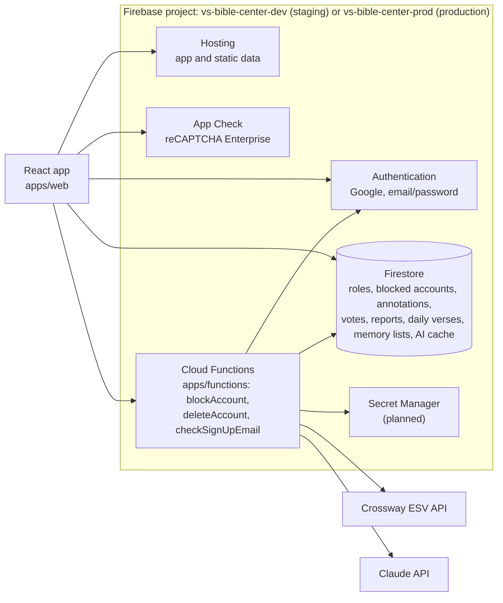

### Repository Layout

| Path | Holds |
| --- | --- |
| `apps/web` | The React app, with its env files, Vite and Playwright config, unit tests in `tests` and E2E specs in `e2e`. `@/` is an alias for its `src`. |
| `packages/core` | `@bible-center/core`: types and pure logic shared across the repo, with no browser or Firebase dependencies. |
| `scripts` | Emulator helpers, the deploy checks and the list of hosted projects (`environments.ts`), and the data generators. |
| `tests` | Tests that belong to the repo as a whole: security rules and scripts. Workspace unit tests live in each workspace's `tests` folder. |
| `apps/functions` | `@bible-center/functions`: the Cloud Functions, each with its own service account named in `.env.<project id>`. They share only types with `@bible-center/core`, since a deploy uploads this folder alone. Built to `lib` with `npm run build:functions`, which the emulator and deploy commands run first. |

## Tech Stack

| Concern | Choice |
| --- | --- |
| UI | React, TypeScript, Mantine, SCSS |
| Routing | React Router |
| State | Zustand for app state, TanStack Query for fetched data |
| Backend | Firebase Authentication, Firestore, Hosting, App Check; Cloud Functions when needed |
| Build | Vite, npm workspaces |
| Tests | Vitest with React Testing Library, Playwright, Firebase emulators |
| Linting | ESLint with `@stylistic` and `react-hooks` |

TypeScript stays on 6.0 until `typescript-eslint` supports 7.

## Bible Text

### Translations

| Translation | Source | Delivery | Status |
| --- | --- | --- | --- |
| Berean Standard Bible (default) | [bereanbible.com/bsb.txt](https://bereanbible.com/bsb.txt), public domain (CC0) | Static files | Built |
| King James Version | [openbible.com/textfiles/kjv.txt](https://openbible.com/textfiles/kjv.txt), the Pure Cambridge Edition. Public domain in the US; see below | Static files | Built |
| English Standard Version | [Crossway API](https://api.esv.org/), non-commercial terms | Cloud Function | Waiting on Crossway |

NIV and NKJV are out of scope: both need paid or publisher licensing.

**KJV outside the US:** in the United Kingdom the KJV remains under a perpetual Crown patent, administered by Cambridge University Press, even though it is public domain elsewhere. The site is reachable from the UK, so review this before any wider launch. The source file brackets words its translators added; the build removes the brackets and keeps the words.

The default is BSB until a visitor picks another translation, which is remembered in that browser (`apps/web/src/stores/translation.ts`). For signed-in users it is also saved to `users/{uid}`, so it follows them between devices (`apps/web/src/stores/useTranslationSync.ts`). ESV is not the default because its limits are shared by all users (60 requests a minute, 5,000 a day).

### ESV Rules

These come from Crossway's [API terms](https://api.esv.org/) and constrain the whole app, so check them again before relying on them:

- **ESV text never enters this public repository**, including fixtures, seeds and logs.
- The API key stays in Secret Manager and is only used from Cloud Functions.
- The site cannot charge for access, carry ads or sponsorships, or solicit donations.
- At most 500 verses or half a book, whichever is less, per request, per page and in any cache. Full-text indexing is therefore not possible.
- Each page using the text labels quotations "ESV", links to esv.org, and includes the copyright notice.
- Crossway can revoke access at any time, so the app must keep working without ESV.

### Reading Flow

Translations are interchangeable behind one interface. The reader never knows where text came from, and a new translation means a new provider rather than changes to the reader.

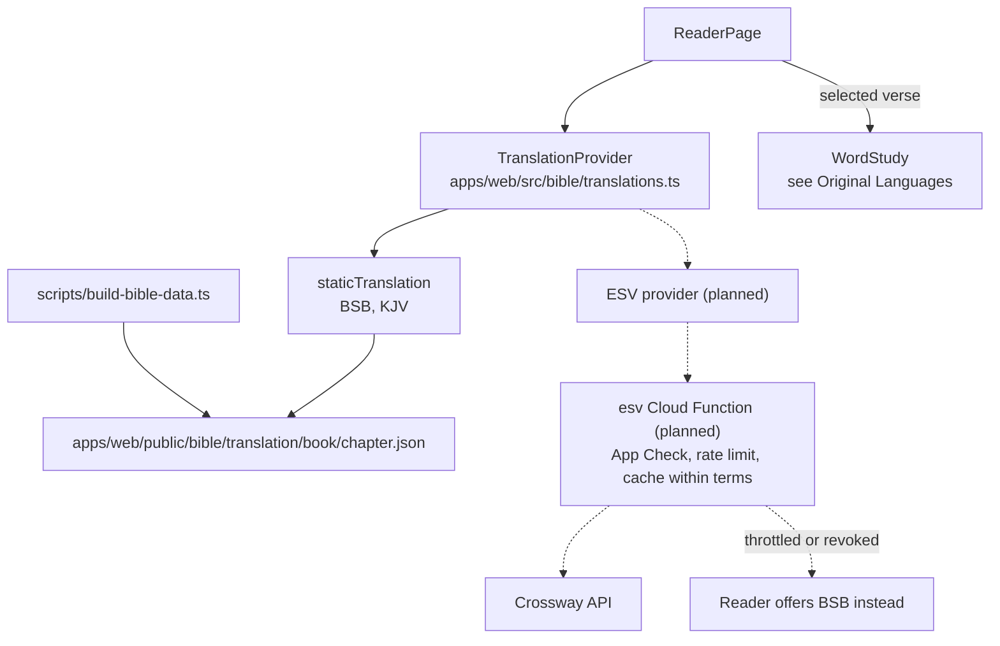

`scripts/build-bible-data.ts` downloads each source, checks that every chapter is present, and writes one JSON file per chapter. The output is committed, so a build needs no network and every change to the text is reviewable. It adds about 14 MB across 2,378 small files, marked as generated in `.gitattributes`. Run `npm run bible-data` only to change a source.

Source files run a psalm's title into verse 1 (`A Psalm of David. The LORD is my shepherd`), so the reader shows it that way rather than as the separate line in the mockup. A verse a translation omits, such as Matthew 17:21 in the BSB, is left out and the numbering shows the gap.

### Verse Identity

Annotations and votes are stored against a `VerseId`, never verse text, so they carry across translations and copyrighted text is not copied into Firestore. A `VerseId` is OpenBible's eight-digit `bbcccvvv` format: John 1:1 is `43001001`. See `packages/core/src/verseId.ts`.

Translations occasionally number verses differently. STEPBible's versification data (TVTMS) is the planned source for mapping them; the first non-matching translation will decide whether it is needed.

### Search

One search box handles references and remembered wording, at `/search?q=` (`apps/web/src/pages/SearchPage.tsx`). It searches the selected translation only. A search that is exactly a topic's name also links to that topic, through `findTopic`.

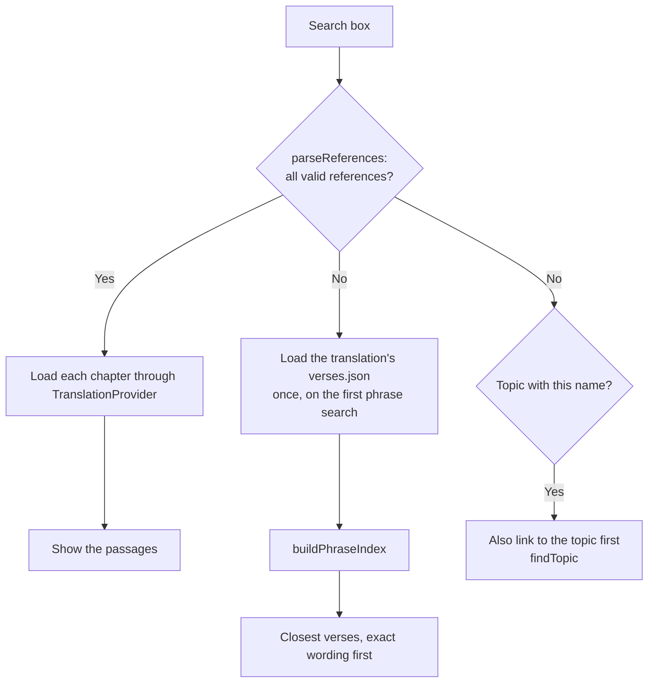

- **References** (`packages/core/src/references.ts`) accept book names and common abbreviations, ranges, whole chapters, and lists like `John 1:1; Acts 2:3-4; Revelation 22:13`. A search counts as references only if all of it is valid, so everything else falls through to phrase search.
- **Phrases** (`apps/web/src/bible/phraseSearch.ts`) use MiniSearch in the browser over `apps/web/public/bible/<translation>/verses.json`, about 4.5 MB per translation, or 1.3 MB compressed. Exact wording ranks first. Words of four or more letters tolerate typos and match by prefix, shorter ones must match exactly, and a verse needs at least half of the search's words.
- **Paraphrases** often work without AI. Against the real BSB, `I do not consider my life of any value nor as precious to myself` ranks Acts 20:24 first, and `the lord is my sheperd` finds Psalm 23:1 in the top two. Embeddings remain a possible later addition for wording that shares few words with any translation.
- **ESV** cannot be indexed because of the cache limit, so phrase search only covers translations offering `verses.json`.

Indexing takes about 300 ms on a laptop and happens once per translation, and most searches take under 40 ms. It runs on the main thread, so move it to a Web Worker if it proves noticeable on phones. Selecting a phrase result opens the verse in the reader, scrolled to and marked via `#v<verse>`.

## Annotations

Signed-in users can highlight, bookmark and add notes to a verse or a range of verses within a chapter. Annotations store verse ids rather than text, so they appear in every translation and copy no scripture into Firestore.

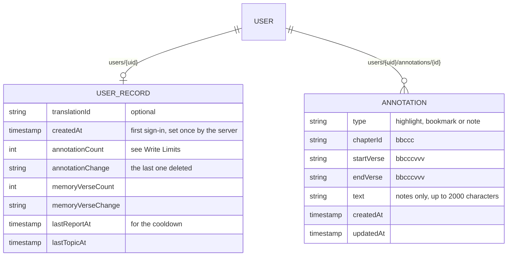

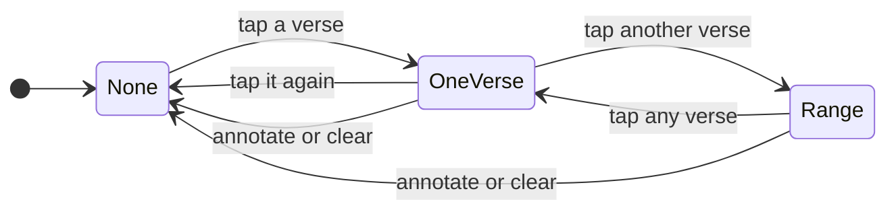

- **Selecting:** `selectVerse` in `packages/core/src/annotations.ts` implements this state diagram, for taps and for the verse number buttons, which are how keyboards reach it. Dragging across words to copy them does not select a verse. Anyone can select a verse, to see its [original words](#original-languages); only signed-in users with a verified email get the annotation tools. `ReaderPage` holds the selection, so the word panel beside the text can follow it.
- **Reading a chapter:** `useChapterAnnotations` queries by `chapterId`, the first five digits of a verse id. A range cannot cross chapters, since the reader shows one at a time.
- **Toggling:** if a selection overlaps any highlight or bookmark, the action removes every one it touches, even if it extends beyond the selection. Otherwise it adds one. Selecting over a note opens that note for editing.
- **Rules:** `firestore.rules` limits access to the owner, with a verified email. It also validates every field, requires server timestamps, keeps both ends of a range in the chapter, and only lets a note's text change. `tests/rules/users.spec.ts` covers this.
- **Loading:** actions stay disabled until a chapter's annotations load, since they cannot know what is already marked, and could add a duplicate instead of removing. Offline, the Firestore SDK answers queries from its empty cache instead of failing, so `listChapterAnnotations` treats a cached answer as a failure and retries with backoff. That way an outage shows an error rather than looking like having no annotations.
- **My verses:** `useAnnotationPages` reads 20 annotations at a time through `listAnnotationPage`, with Firestore doing the filtering and ordering, and "Show more" continues from the last one. Recently added orders by `createdAt`, and Bible order by `startVerse` then `endVerse`, since verse ids sort canonically as strings. Each ordering, alone and after a type filter, needs a composite index in `firestore.indexes.json`. The emulators do not check indexes, so a query added without one passes every test and fails only on the hosted project. Each entry loads its chapter in the selected translation through the same `chapterQuery` the reader uses, so a chapter is fetched once however many entries it has. The filter and order live in the URL (`?show=note&order=bible`), so they survive a trip to the reader and back. Removing asks for confirmation first, since a removed note's words cannot be recovered.
- **Keeping pages in step:** every annotation query key starts with `annotationQueryKeys.forUser`, and every change invalidates that prefix, so a change on either page refreshes the other's cached data.

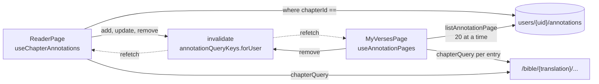

- **Limits:** a user can keep up to 5,000 annotations, counted on their `users/{uid}` record; see [Write Limits](#write-limits).

## Verse of the Day

The home page shows one verse or short passage each day. An admin can choose it for any date, and any date without a choice gets an automatic pick, so the home page never needs attention.

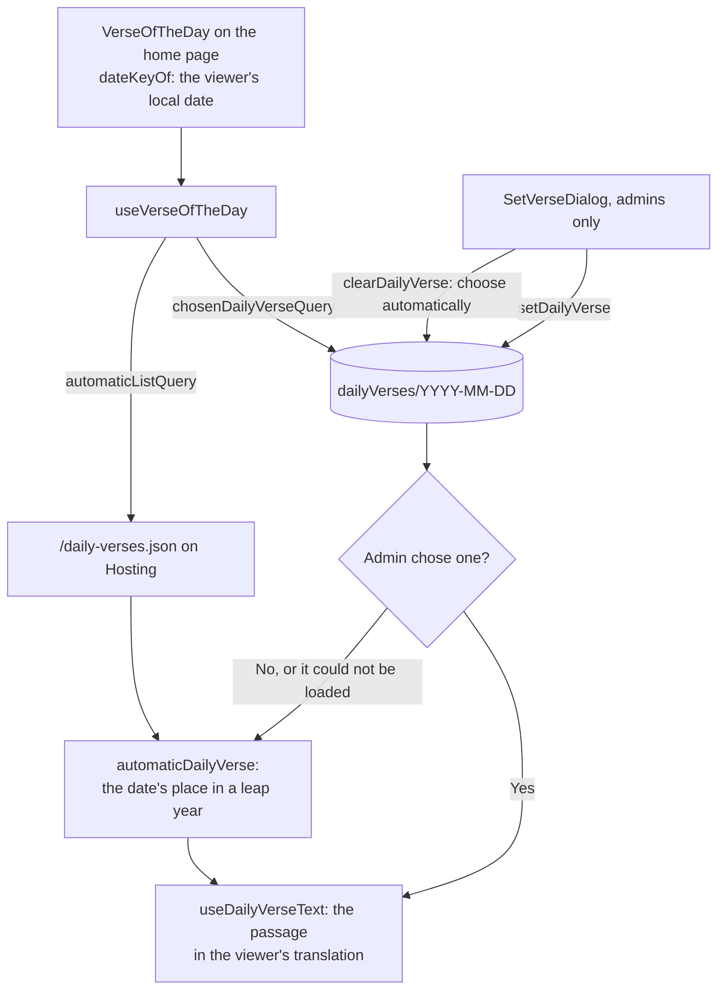

- **Choosing:** admins get "Set verse of the day" beside the verse, which opens `SetVerseDialog` on today's date. It loads what is set for the chosen date, then offers "Choose automatically" or a verse or passage, checked with `useReferenceSpan` (shared with adding a verse to a topic), and previews what visitors will see. Choosing automatically deletes the date's document. An admin has a `roles/{email}` entry with the `admin` role (see [Roles and Review](#roles-and-review)); `firestore.rules` lets only `isAdmin` write to `dailyVerses`, and `tests/rules/dailyVerses.spec.ts` covers it.
- **Dates:** each viewer sees the verse for their own date (`dateKeyOf`), so it changes at their midnight. `dayOfLeapYear` gives each month and day a fixed place from 0 to 365, so a date gets the same automatic verse every year, and only February 29 is skipped outside leap years. Everyone on the same date sees the same verse, and nothing runs on a schedule.
- **Storage:** a `VerseId` range, not text, so the verse appears in the viewer's translation. The list and documents hold no scripture. A document holds `startVerse`, `endVerse`, `setBy` and `setAt`, and a passage stays within one book.
- **Reading:** anyone can read a single date's document, but not list the collection. If it cannot be read, the automatic pick shows instead, so the home page always has a verse.

Building the automatic list, once:

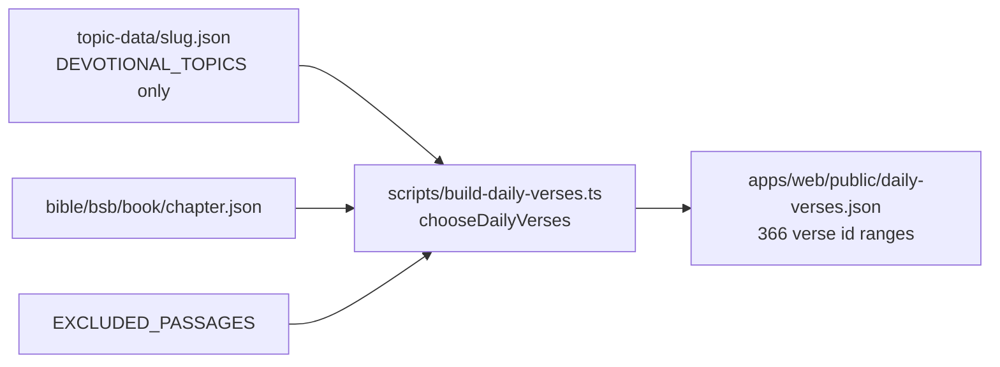

`npm run daily-verses` adds up each passage's OpenBible votes across about 50 encouraging topics, such as hope, comfort, strength and God's love. Counting every topic brought in verses on divorce and idolatry, since OpenBible's votes measure how well a verse fits a topic, not how encouraging it is. It keeps passages of up to 3 verses and 160 BSB characters that read as whole sentences, with no quotation left open. It leaves out a psalm's first verse, which often begins with the psalm's title, and anything in `EXCLUDED_PASSAGES`. Of overlapping passages, it keeps the most-voted. The top 366 are shuffled with a fixed seed, so the best-loved verses are spread across the year and a rebuild from the same data gives the same order. The list is committed, and the owner approved it on November 10, 2026. To leave a passage out later, add it to `EXCLUDED_PASSAGES` and run `npm run daily-verses`; to change which topics count, edit `DEVOTIONAL_TOPICS`. An admin can also override any single date from the home page.

## Topic Search

"What does the Bible say about ___?" ranks verses using three sources: Bible Center upvotes, OpenBible's votes as a starting point, and AI suggestions to fill gaps.

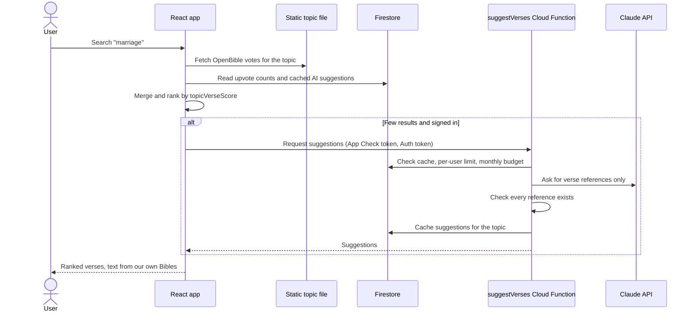

### Ranking

Implemented in `packages/core/src/topicScore.ts`:

```text
seedScore = 20 × log(1 + openBibleVotes) / log(1 + topicMaxOpenBibleVotes)
score     = seedScore + upvotes
```

OpenBible's counts are too large to add directly: Genesis 2:24 has 2,953 votes for "marriage", so Bible Center's votes could never change the order. The log scale keeps OpenBible's order but compresses each topic to a 0-20 starting score. For "marriage", the top verse starts at 20 and a verse with 14 votes starts at about 7.

Each upvote adds 1, so 21 upvotes put a verse with no OpenBible votes ahead of that topic's top verse. As the community grows, its votes outweigh the seed without any migration. To change how quickly that happens, change `MAX_SEED_SCORE`.

The app shows OpenBible and Bible Center counts separately rather than the combined score.

### Voting

- Upvotes only. Users can remove their own upvote, and can report an entry that does not belong.
- Signed-in users can upvote an existing verse or associate a verse with a topic, once their account is at least `VOTER_MIN_ACCOUNT_DAYS` (7) days old, so a crowd of new accounts cannot move a verse. `recordFirstSignIn` in `apps/web/src/firebase/settings.ts` sets `createdAt` on `users/{uid}` the first time the auth store sees an allowed user, as the server's time, and the rules never let it change. `isEstablished` in `firestore.rules` checks it on every new vote, which covers adding a verse, since that creates its adder's vote. Removing an upvote has no such check. A newer account's topic pages say when it can vote, from `accountCreatedAt` in the auth store and `votingOpensAt`, with its vote boxes turned off and no way to add a verse; it can still report. Upvotes are not capped against the OpenBible seed, since the ranking formula is settled; the account age, reports and reviewers handle abuse instead.
- One vote per user for each verse and topic, enforced by the document path and security rules.
- Counts are checked by the security rules rather than kept by a Cloud Function. `upvoteVerse` and `removeUpvote` in `apps/web/src/firebase/topics.ts` change a vote and its count in one transaction, and the rules use `existsAfter` and `getAfter` to accept a count change only when that user's vote is created (+1) or deleted (-1) in the same write, and a vote only when its count moves with it. Adding a verse to a topic creates its count at 1 alongside the adder's vote. A transaction retries when someone else votes at the same moment, so no vote is lost. `tests/rules/topics.spec.ts` tries each way of changing a count without a vote.
- Anyone can read the counts. A user's own votes are found with one collection-group query on `uid` and `topic`, and nobody else can read them.
- Reports go to `reports` for review, with a reason from `REPORT_REASONS` and up to 500 characters of details. They do not change the ranking, so they cannot be used to bury verses. Only reviewers can read them; see [Roles and Review](#roles-and-review).
- Topic names are normalized (trimmed, lowercased, single spaces). Adding the first verse to a topic OpenBible does not have starts it, as a `topics/{slug}` document with `status: 'pending'`. It works by its link, but is not listed or linked from search until a reviewer approves it. A rejected topic's page says it is not available, and nobody can add verses to it.
- A verse a reviewer removed from a topic has a `topics/{slug}/removed/{key}` document. `rankTopicVerses` leaves it out, which hides OpenBible's verses too, and nobody can add it back.
- A verse someone adds starts with one vote, so it usually ranks low. The page grows to include it and scrolls to it, so the person sees it was added.

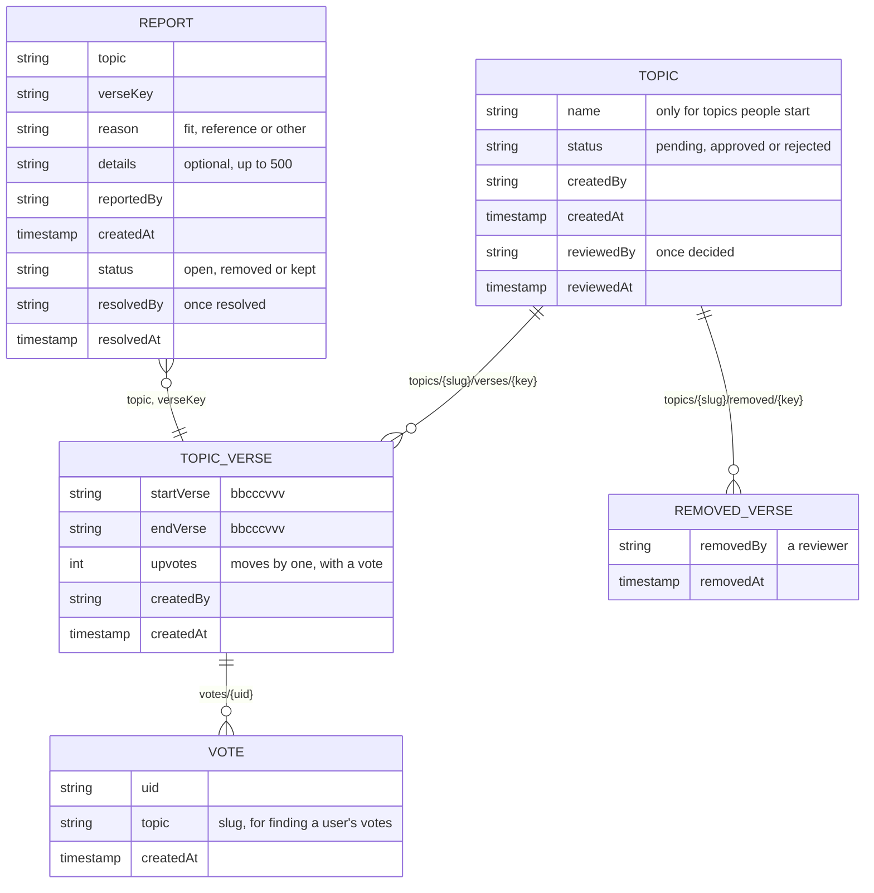

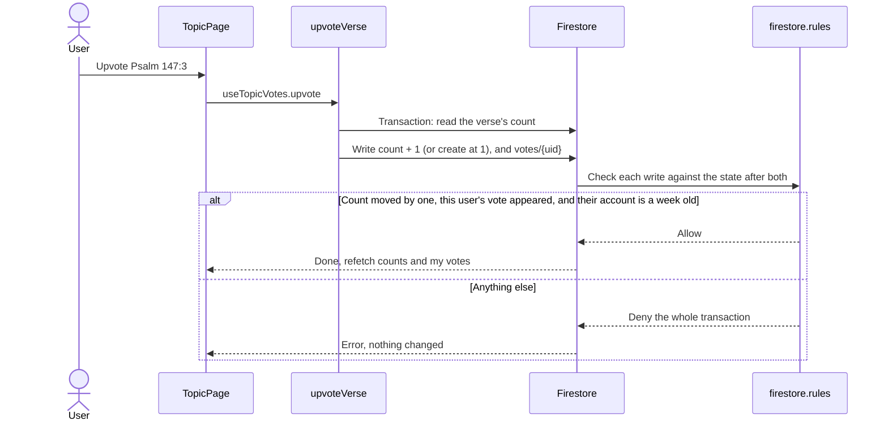

### OpenBible Data

[OpenBible.info's topic data](https://www.openbible.info/topics/) is licensed CC BY, so the app must credit it with a link wherever it is shown. The [vote file](https://a.openbible.info/data/topic-votes.txt) is refreshed weekly upstream and contains only topics, verse references and vote counts, with no scripture text. As of November 2026 it has about 470,000 rows across 6,751 topics. Each row may be a range (`Topic`, `Start Verse ID`, `End Verse ID`, `Votes`).

`scripts/build-topic-data.ts` (`npm run topic-data`) splits it into one static JSON file per topic on Hosting, so reading a topic costs no Firestore reads. Names are normalized (trimmed, lowercased, single spaces), and spellings that share a slug, such as "self control" and "self-control", become one topic named by the more-voted spelling, keeping a passage's higher count where both list it. That leaves 6,739 topics. Rows naming a verse that does not exist are dropped. `_index.json` lists every name, for the Topics page and for spotting a search that names a topic, and `topicNamesQuery` adds the approved topics people started from Firestore. If those cannot be loaded, OpenBible's topics still show; no slug starts with an underscore, so it never collides with a topic. The output is committed, like the Bible text: about 13 MB across 6,740 small files, marked as generated in `.gitattributes`. Refreshing means rerunning the script and committing the result. Bible Center votes are unaffected, since they are keyed by topic slug and verse ids.

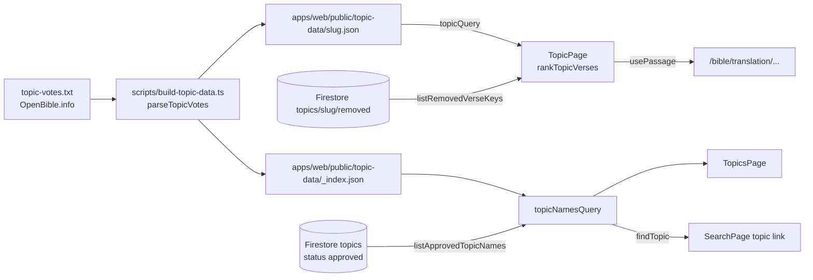

Hosting and the dev server answer a missing file with the app's HTML page rather than a 404, so `fetchTopicData` treats any answer that is not JSON as "no such topic". A topic OpenBible does not have shows as empty, ready for someone to add the first verse.

### AI Suggestions

Claude Opus 5.5 fills gaps only. OpenBible already covers the common topics.

- Only signed-in users can trigger a lookup, with a per-user limit and a hard **$10 monthly** cap.
- Each topic is looked up once. The cached result is shared with everyone.
- The model returns references only. Every reference is checked, and verse text always comes from our own Bibles.
- Suggestions are labeled as AI-suggested, start with a low score, and appear only for topics with few results. Upvotes raise them like any other verse.

Estimated cost at the time of the decision is about $0.03 per new topic ($4 / $20 per million input / output tokens, about 500 input and 1,500 output tokens). Replace this with measured numbers once it runs.

## Memorization

Anyone can practice a verse or passage by heart at `/memorize/practice?passage=Psalm 23:1-2`, reached from the Memorize page, the reader's verse tools, or beside the verse of the day. Signed-in users also keep a memory list.

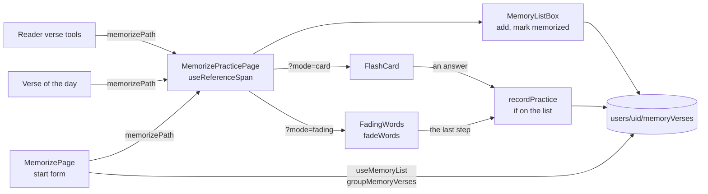

- **Flash card:** the reference, then the verse when turned over, and "Did you have it?" with "Not yet" and "I knew it". A count of answers lasts for the visit only.
- **Fading words:** `fadeWords` in `packages/core/src/memorize.ts` gives five steps: every word, one in three hidden, two in three, first letters only, then none. Punctuation stays in view, and selecting a blank shows that word.
- **The passage** is any one reference, checked with `useReferenceSpan`, the same check as adding a verse to a topic, and shown in the selected translation. A psalm's first verse includes its title, as the source text runs them together.
- **The memory list:** each entry is learning or memorized. A memorized verse is due for review `REVIEW_AFTER_DAYS` (7) after it was last practiced, and `groupMemoryVerses` lists due verses first, then learning, then memorized. Answering the flash card or reaching the last fading step updates `practicedAt` for a verse on the list, so practicing a due verse moves it back among the memorized ones. There is no spaced-repetition schedule beyond this.
- **Rules:** as with annotations, only the owner with a verified email can read or change their list. An entry is keyed like a topic's verse, starts as learning, and only its `status` and `practicedAt` can change, with `practicedAt` set by the server. `tests/rules/memoryVerses.spec.ts` covers this. The list holds up to 500 verses; see [Write Limits](#write-limits).

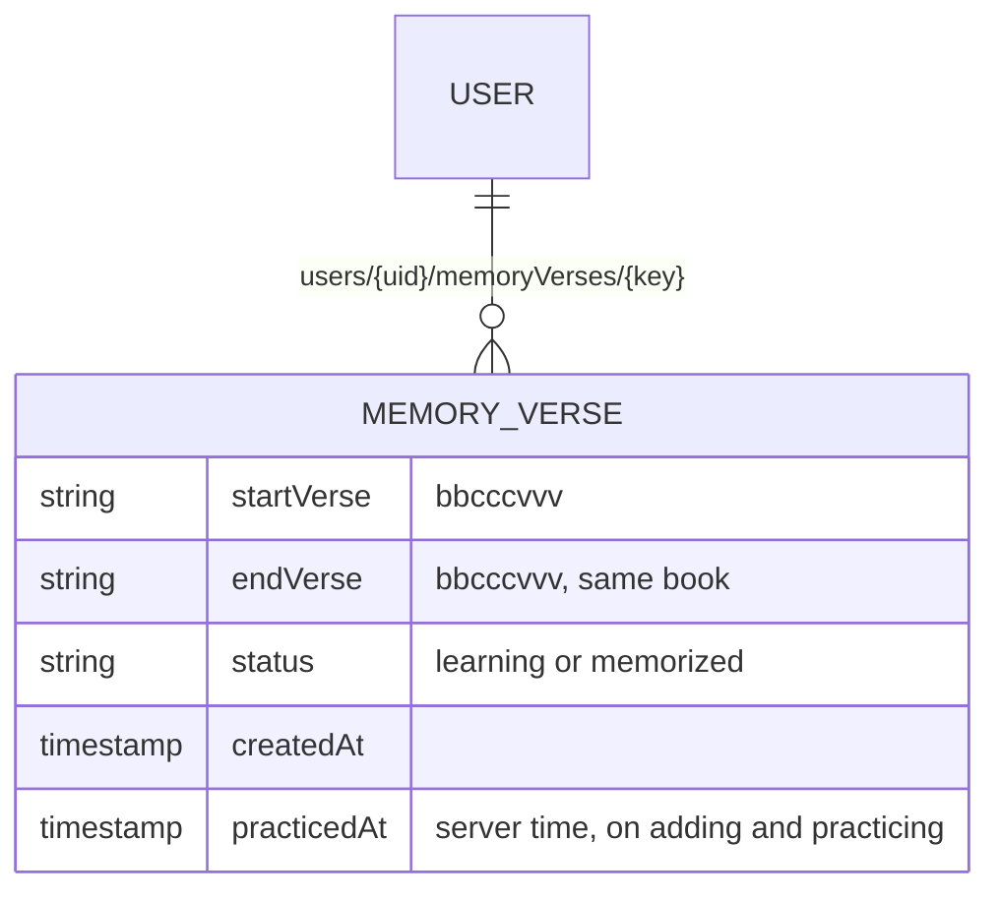

## Original Languages

| Data | Source | License |
| --- | --- | --- |
| Hebrew and Greek tagged text (TAHOT, TAGNT) | [STEPBible](https://github.com/STEPBible/STEPBible-Data), from Tyndale House | CC BY 4.0. Credit STEP Bible and Tyndale House with a link to [STEPBible.github.io/STEPBible-Data](https://stepbible.github.io/STEPBible-Data/), and note any changes |
| Brief lexicons (TBESH, TBESG) and morphology expansions (TEHMC, TEGMC) | STEPBible | CC BY 4.0 |

Anyone can select a verse in the reader, signed in or not, to see its words in the original language: Hebrew for the Old Testament, with Daniel's and Ezra's Aramaic labeled as Aramaic, and Greek for the New. Selecting a word shows its transliteration, English, dictionary form, main senses, grammar and Strong's number, which links to STEP Bible. On desktop the panel sits beside the text, stays in view as the chapter scrolls, and follows the selection, emptying when it is deselected. With several verses selected, it starts on the first and arrows step through the rest, the verse it is on marked in the text; on phones a "Hebrew words" or "Greek words" button among the verse's tools opens it in a sheet.

Building the data, once:

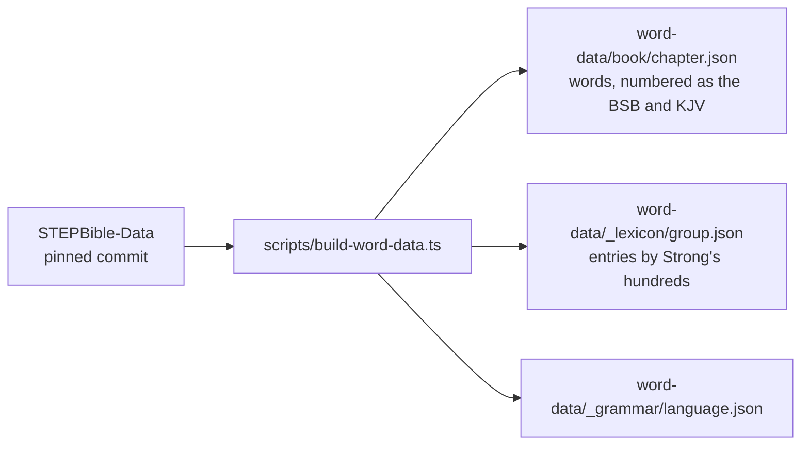

Reading it, for the verse the panel is on:

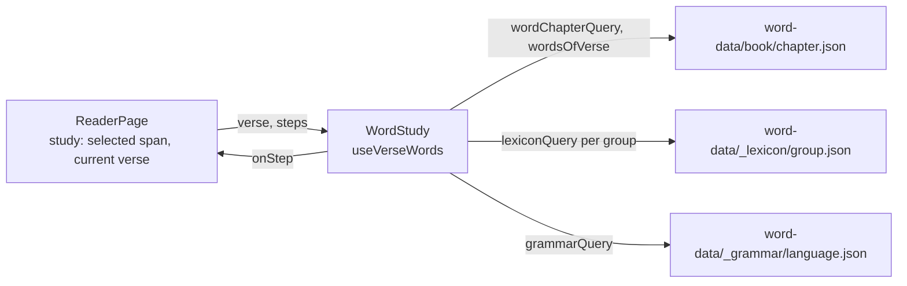

- **Building:** `scripts/build-word-data.ts` (`npm run word-data`) downloads a pinned commit of STEPBible-Data and writes about 28 MB across 1,346 files, committed and marked as generated in `.gitattributes`. A chapter's file holds its words; dictionary entries are shared in 155 files by Strong's number in hundreds (`lexiconGroup`), so a common word is stored once; and one file per language describes the grammar codes. To update, change `STEPBIBLE_COMMIT` and rerun.
- **Changes to STEPBible's data,** which its license asks to be noted: Hebrew cantillation marks and STEPBible's prefix and suffix dividers are removed, vowels kept; lexicon definitions are shortened to up to three main senses; grammar codes are spelled out in plain English; and words are renumbered to the BSB's and KJV's verses, as below.
- **Which Greek:** the panel follows the translation being read. The BSB translates the Nestle-Aland text and the KJV the Textus Receptus, so a word only one has is marked with that translation. Where they read differently at the same place, as in John 1:18 ("God" or "Son"), the KJV's word comes from STEPBible's meaning variants. The BSB also translates Mark 16:9-20 and John 7:53-8:11, which Nestle-Aland brackets.
- **Numbering:** STEPBible numbers verses by the NRSV. A Psalm's title, its verse 0, joins verse 1, as the BSB and KJV print it. In 52 places the KJV puts Greek words in the next or previous verse; each word records the KJV's verse, and `BSB_FOLLOWS_KJV` lists the 20 where the BSB does the same, found by comparing its verses with the words' English. At Revelation 12:18 both start chapter 13. The script refuses to write anything if a verse of either translation has no words, or words land in a verse it does not have.
- **Fonts:** Noto Serif Hebrew for Hebrew and Aramaic, read right to left, and Gentium Book Plus for Greek.
- **Not yet:** selecting an English word to find its source word needs tagging data for each translation; BSB's translation tables are the candidate, and their contents have yet to be checked.

## Authentication and Access

Anyone can read the Bible without an account. Anyone with a verified email can sign up, with Google or by email and password, and signing in unlocks annotations, the memory list and voting. Roles are kept separately; see [Roles and Review](#roles-and-review).

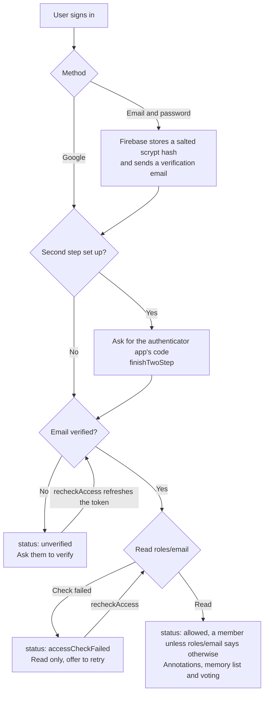

`apps/web/src/stores/auth.ts` holds this status and the role, and `SignInPage` shows the panel for the status. The status only shapes the interface; the security rules enforce access.

**The verified-email check is what keeps sign-up safe.** Anyone can register a password account using someone else's address, so an unverified email proves nothing. `isVerified()` in `firestore.rules` requires `email_verified` before accepting any write, and `tests/rules/access.spec.ts` covers this. Abuse by accounts that are real but unwanted is handled by the [write limits](#write-limits), the week before an account can vote, [blocking](#blocking), and reviewing whatever becomes public.

Firebase handles the password storage. The app never sees or stores a password. Firebase keeps one account per email by default, and a Google sign-in takes over an unverified password account with the same address, removing the password.

### Two-Step Sign-In

Reviewers and admins sign in with a second step, a code from an authenticator app (TOTP), so a stolen password or Google account alone cannot act as them. Members never need it.

- **Rules:** `hasSecondFactor()` in `firestore.rules` checks that this sign-in used a second step (`firebase.sign_in_second_factor` in the token), and `isReviewer()` and `isAdmin()` require it. `requireAdmin` in `apps/functions` checks the same. The project offers only authenticator apps; the Auth emulator offers only SMS, which the rules accept the same way, so the E2E tests can act as staff.
- **Setting it up:** `RoleGate` shows `TwoStepSetup` in place of the Review and People pages until the person has a second step on this sign-in. They confirm it is them (`confirmItIsYou`, by password or Google), scan a QR code or type the key (`startAuthenticatorSetup`, with `qrcode-generator`), and enter a code (`finishAuthenticatorSetup`). Only a new sign-in carries the second step, so they then sign in again. Someone who has it set up but signed in before setting it up is asked to sign in again.
- **Signing in:** when an account with a second step signs in, Firebase asks for it. The auth store keeps the `twoStepResolver` (`signInWith`), and `SignInPage` shows `TwoStepCodePanel` until `finishTwoStep` succeeds. `apps/web/src/firebase/twoStep.ts` holds these Firebase calls.
- **Losing the app:** `scripts/reset-two-step.ts` turns it off for one account; see [DEPLOYMENT.md](docs/DEPLOYMENT.md#resetting-two-step-sign-in).
- **Temporary emails:** `checkSignUpEmail`, an Identity Platform blocking function, refuses a new account whose email is on mailchecker's list of temporary email services. Firebase passes the refusal to the app as an internal error with `TEMPORARY_EMAIL_ERROR` in its message, which `authErrorMessage` explains. Its service account has no roles.

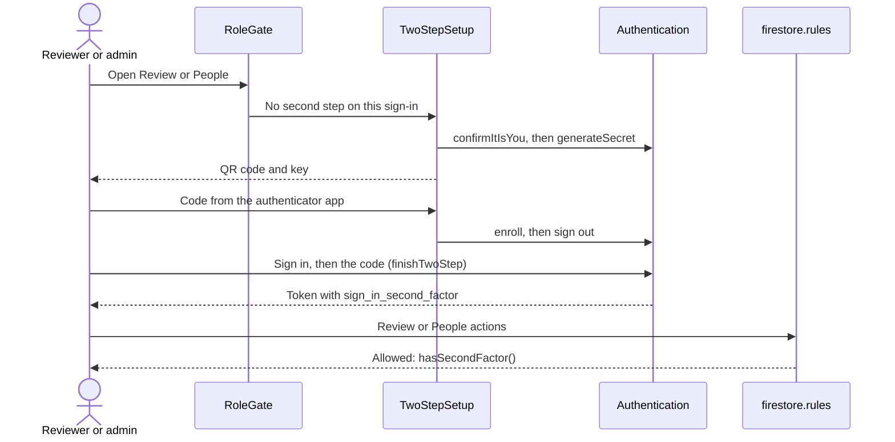

`tests/rules/access.spec.ts`, `tests/functions/checkSignUpEmail.spec.ts`, `apps/web/tests/TwoStepSetup.spec.tsx` and `apps/web/e2e/two-step.spec.ts` cover this.

## Roles and Review

Reviewers and admins have an entry in `roles/{lowercase email}` holding their `role`. Everyone else is a member, so members have no entry. Roles are keyed by email rather than account id because admins grant them by email, often before the person has signed in. Each role can do everything the ones before it can:

| Role | Can also |
| --- | --- |
| Member | Highlight, bookmark, take notes, vote, add verses, start topics and report verses |
| Reviewer | Remove reported verses or keep them, and approve or reject topics people start, on the Review page (`/review`) |
| Admin | Give, change and remove roles and block accounts, on the People page (`/people`), and set the [verse of the day](#verse-of-the-day) from the home page |

- **Roles in code:** `ROLES`, `canReview` and `isAdmin` in `packages/core/src/roles.ts`. `getAccess` in `apps/web/src/firebase/access.ts` reads the person's `roles` entry once their email is verified, and the auth store keeps it. `RoleGate` shows a page only to its roles and `useAccountLinks` lists the pages each role can open. These only shape the interface; `myRole`, `isReviewer` and `isAdmin` in `firestore.rules` enforce it.
- **Managing roles:** only admins can read or change `roles`, and never their own entry, so there is always an admin and nobody can promote themselves. Each write records `updatedBy` and `updatedAt`. On the People page, `apps/web/src/firebase/people.ts` gives a role by email (`giveRole`, refused if the email already has one, so it is changed in the list instead), changes it (`changeRole`), or makes someone a member again by deleting the entry (`removeRole`). A role can be given before the person has signed in. The first admin is set in the console; see [DEPLOYMENT.md](docs/DEPLOYMENT.md#roles).
- **The queue:** `useReviewQueue` loads the open reports and pending topics, oldest first, which needs the two `status, createdAt` indexes. `groupReports` gathers reports by topic and verse, so a reviewer decides once for each. The account menu shows how many are waiting. A decision stays on the page, with its outcome, until the queue next loads.
- **Resolving reports:** `resolveReports` closes every report in a group in one transaction. Removing also creates `topics/{slug}/removed/{key}` in the same write, and the rules only accept a report closed as removed when that document exists afterwards.
- **Deciding topics:** `decideTopic` sets a pending topic to approved or rejected, once. Approved topics join the Topics page and search links; rejected ones are hidden and closed to new verses.

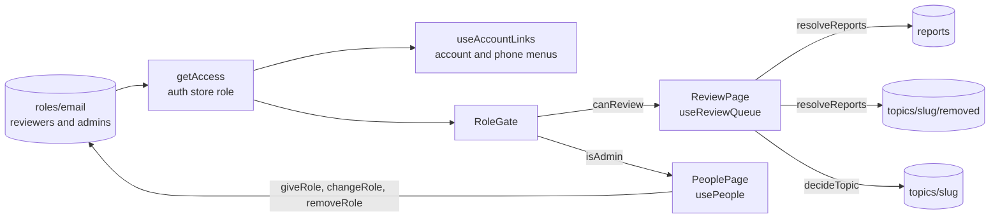

`firestore.rules` checks every write in this diagram with `isReviewer` or `isAdmin`.

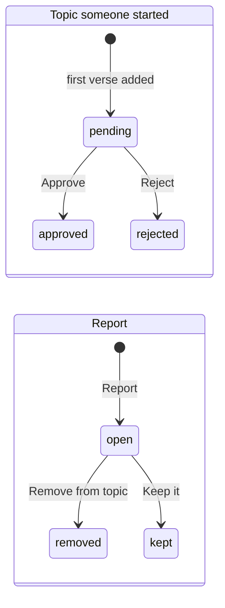

```mermaid
sequenceDiagram
  actor Reviewer
  participant Page as ReviewPage
  participant Fn as resolveReports
  participant Firestore
  participant Rules as firestore.rules

  Reviewer->>Page: Remove from topic
  Page->>Fn: useReviewQueue.resolve(group, removed)
  Fn->>Firestore: Transaction: is the verse already removed?
  Fn->>Firestore: Create topics/slug/removed/key, and close each report in the group
  Firestore->>Rules: Check each write against the state after all of them
  alt Reviewer, and the removed document exists after the write
    Rules-->>Firestore: Allow
    Firestore-->>Page: Done, mark the item removed and refresh the topic
  else Anything else
    Rules-->>Firestore: Deny the whole transaction
    Firestore-->>Page: Error, nothing changed
  end
```

### Blocking

Admins block an account that misuses Bible Center. A blocked account can still read, but the rules refuse everything it writes, at once, unlike disabling the account in the console, which waits for its sign-in token to expire.

- **Records:** `blockedUsers/{uid}` holds the account's email, who blocked it and when, and whether its content was removed (`BlockedAccountRecord` in `packages/core/src/accounts.ts`). `isBlocked()` in `firestore.rules` checks it in `canWrite()`, which every write rule uses, and in `isReviewer()` and `isAdmin()`, so a blocked reviewer or admin cannot act either. Admins list and unblock; nobody writes the records directly.
- **The function:** `blockAccount` in `apps/functions` is a callable function, so it can find an account by email with the Admin SDK, which the People page needs. It checks the caller as `isAdmin` does (`requireAdmin`), refuses to block the caller, and writes the record. With `removeContent`, `userContent.ts` also takes away the account's upvotes (each with its count, as the rules require of people), deletes its reports and the verses it added, and rejects the topics it started. Those queries need the collection-group single-field indexes on `votes.uid` and `verses.createdBy` in `firestore.indexes.json`.
- **In the app:** the People page blocks by email and lists blocked accounts with Unblock (`BlockedAccounts`). On the Review page, admins see when the account behind each reported verse, report and new topic joined, read from `users/{uid}.createdAt`, which the rules let admins read, and can block it there (`AccountLine`). Both use `BlockDialog` and `useBlockedAccounts`.
- **For the blocked account:** the auth store reads its own `blockedUsers` entry at sign-in (`isAccountBlocked`), and checks again whenever a save is refused for permission (`wasRefusedForBlock`, from the query client's mutation cache and from the report and add-verse dialogs). While `isBlocked`, each place that would save says why it cannot, with `BlockedNotice` and the support address in `SupportContact`, and turns its controls off: topic votes, adding and reporting; the reader's annotation tools and note editing; the memory list; Remove on My verses and Memorize; and, for staff, the Review and People pages through `RoleGate` and setting the verse of the day. Reading, practicing and the word study work as before.
- **Service account:** `blockAccount` runs as `sa-bc-block-account-dev`, which can read and write Firestore and look up accounts, and nothing else; see [DEPLOYMENT.md](docs/DEPLOYMENT.md#cloud-functions).

```mermaid
sequenceDiagram
  actor Admin
  participant Page as People or Review page
  participant Fn as blockAccount
  participant Auth as Authentication
  participant Firestore

  Admin->>Page: Block, by email or from an item
  Page->>Fn: Call with App Check and ID tokens
  Fn->>Firestore: requireAdmin: roles/email is admin, not blocked
  alt By email
    Fn->>Auth: getUserByEmail
  end
  Fn->>Firestore: Set blockedUsers/uid
  opt Also remove its content
    Fn->>Firestore: Remove its votes and counts, delete its reports and verses, reject its topics
  end
  Fn-->>Page: Blocked
  Note over Firestore: From now on, canWrite() refuses every write from that account
```

`tests/rules/blockedUsers.spec.ts` and `tests/functions/blockAccount.spec.ts` cover this.

### Account Deletion

Anyone signed in can delete their account from the account menu or the phone menu, as the privacy policy at `/privacy` (`PrivacyPage`, linked from the footer, the phone menu, the account menu and the register screen) promises. `DeleteAccountDialog` lists what goes and what stays, and asks the person to type "delete". It calls the `deleteAccount` function, then signs out, and the home page says the account is gone.

- **What goes:** `deleteAccount` in `apps/functions` takes away the account's upvotes with their counts and deletes its reports (shared with [blocking](#blocking) in `userContent.ts`), then deletes `users/{uid}` with its annotations and memory list, its `blockedUsers` entry, and its `roles` entry, then the account itself. The account goes last, so a failure partway leaves the person signed in to try again.
- **What stays:** the verses it added and the topics it started, which others may have upvoted or added to, with `createdBy` removed (`unlinkAddedContent`), so nothing links them to the person.
- **The role**, keyed by email, is removed only for a verified email (`requireSignedIn`), since anyone can register an unverified account with someone else's address.
- **Service account:** it runs as `sa-bc-delete-account-dev`, the only one allowed to delete accounts; see [DEPLOYMENT.md](docs/DEPLOYMENT.md#cloud-functions).

```mermaid
sequenceDiagram
  actor Person
  participant Dialog as DeleteAccountDialog
  participant Fn as deleteAccount
  participant Firestore
  participant Auth as Authentication

  Person->>Dialog: Delete account, then type "delete"
  Dialog->>Fn: Call with App Check and ID tokens
  Fn->>Firestore: Remove its votes and counts, delete its reports
  Fn->>Firestore: Unlink the verses and topics it added
  Fn->>Firestore: Delete users/uid with its annotations and memory list, and its block record
  opt Verified email
    Fn->>Firestore: Delete roles/email
  end
  Fn->>Auth: deleteUser, last
  Fn-->>Dialog: Done
  Dialog->>Person: Sign out, and the home page says the account is gone
```

`tests/functions/deleteAccount.spec.ts` and `apps/web/e2e/account.spec.ts` cover this.

## Security

This repository and the app are public, so assume hostile use. Vulnerabilities are reported privately through GitHub, as [SECURITY.md](SECURITY.md) describes.

- **Firestore** denies everything unless a collection opts in. Rules validate each field and tests cover them.
- **App Check** starts before Auth and Firestore make requests, and stays off against the emulators. It is enforced for Firestore and Authentication, so requests from anything but the deployed app, or a machine with a registered debug token, are rejected. See [DEPLOYMENT.md](docs/DEPLOYMENT.md#app-check-setup).
- **Deploys** are refused without a site key, or with a debug token or emulator flag (`scripts/check-firebase-config.ts`).
- **Secrets** live in Secret Manager. `VITE_` variables end up in the public bundle, so they never hold secrets.
- **Paid or limited services** are reached only through Cloud Functions with App Check, sign-in where appropriate, per-user limits, and a budget cap.
- **Hosting** sends `nosniff`, `X-Frame-Options` and `Referrer-Policy` headers. A Content Security Policy is still to be added, once the app's external origins are settled.

### Write Limits

One account cannot flood reviewers or run up Firestore costs. The limits are in `packages/core/src/limits.ts`, and `firestore.rules` enforces the same numbers:

| Limit | Value | Kept on `users/{uid}` |
| --- | --- | --- |
| Annotations kept | 5,000 | `annotationCount` |
| Memory list verses kept | 500 | `memoryVerseCount` |
| Time between reports | 1 minute | `lastReportAt` |
| Time between starting topics | 10 minutes | `lastTopicAt` |

- **Counts** work like upvotes: creating a counted document must raise its count by one in the same write, below the limit (`addsToCount`), and deleting one must lower it (`takesFromCount`). Lowering a count is only accepted when the document named in `annotationChange` or `memoryVerseChange` is deleted in that write, so nobody can lower their count to get past the limit. Raising it alone only hurts the person doing it. Records from before counts start at 0, so older documents are not counted until the person deletes some.
- **Cooldowns** stamp the server's time on the record in the same write as the report or topic (`stampsAfterCooldown`), and need the last stamp to be old enough. The stamp can only move to now, so it cannot be cleared or backdated.
- **In the app**, `apps/web/src/firebase/userRecord.ts` makes these changes inside each write's transaction, and throws `WriteLimitError` before writing when a limit is reached. `removeAnnotations` removes several one after another, since the rules accept one count change per write and simultaneous ones would be refused rather than retried. The same applies to two tabs saving at once, which is rare enough to leave.
- **Messages** follow the approved `Limits` mockup. `limitOf` tells a `WriteLimitError` from a failed connection: `ReportDialog` and `AddVerseDialog` say when the next report or topic can be sent (`formatTime`) and turn off their buttons, and the reader and `MemoryListBox` say the list is full and link to where to make room.

```mermaid
sequenceDiagram
  actor User
  participant Fn as addAnnotation
  participant Firestore
  participant Rules as firestore.rules

  User->>Fn: Highlight a verse
  Fn->>Firestore: Transaction: read users/uid
  alt annotationCount has reached WRITE_LIMITS.annotations
    Fn-->>User: WriteLimitError, nothing written
  else Below the limit
    Fn->>Firestore: Create the annotation, and set annotationCount + 1
    Firestore->>Rules: Check each write against the state after both
    alt The count rose by one, below 5,000
      Rules-->>Firestore: Allow
    else Anything else
      Rules-->>Firestore: Deny the whole transaction
    end
  end
```

`tests/rules/users.spec.ts`, `memoryVerses.spec.ts` and `topics.spec.ts` try each way around the limits.

### What Is Public

Anything one account writes that others can read is checked here, since open sign-up lets anyone write it. Everything else, including annotations, notes, memory lists, settings and who voted for what, is readable only by its owner.

| Collection | Others can read | Free text | Reviewed before others see it |
| --- | --- | --- | --- |
| `topics/{slug}` | The name, status, and the starter's account id | The name: up to 80 lowercase characters, which must reduce to the topic's slug, so its letters and digits are the ones in its link | Yes. A pending topic is not listed or linked from search until a reviewer approves it |
| `topics/{slug}/verses/{key}` | The reference, its upvote count, and the adder's account id | None | No. A reviewer removes a verse that does not belong when it is reported |
| `topics/{slug}/removed/{key}` | Which verses reviewers removed | None | Written only by reviewers |
| `dailyVerses/{date}` | The reference | None | Written only by admins |
| `reports/{id}` | Reviewers only | Details, up to 500 characters | Not public |

A pending topic is still reachable by its link, which is deliberate, since its starter shares it to gather votes. That is no more exposure than the URL itself: `/topics/<any words>` shows "What does the Bible say about <those words>" even when no topic exists, so hiding pending names would not stop someone from sharing an offensive link. What matters is that no free text an account writes is listed, searchable or linked from the app until a reviewer approves it. Verses added to a topic show at once, but they are only references to text Bible Center already has, and each one keeps the account id of whoever added it.

## Environments and Delivery

```mermaid
flowchart LR
  dev["npm run dev"] -- ".env.development" --> emulators["Local emulators<br/>demo-bible-center"]
  e2e["npm run test:e2e"] -- ".env.development" --> emulators
  rules["npm run test:emulator"] --> emulators
  ci["GitHub Actions ci.yml<br/>pull requests, pushes to main"] --> e2e
  ci --> rules
  devStaging["npm run dev:staging"] -- ".env.staging<br/>.env.staging.local" --> staging["vs-bible-center-dev<br/>vs-bible-center-dev.web.app"]
  deployStaging["npm run deploy:staging<br/>any branch"] --> buildStaging["build-hosting.ts<br/>vite build --mode staging"]
  buildStaging --> staging
  deployProd["npm run deploy:production<br/>main, once tested on staging"] --> release["check-release.ts<br/>clean, at origin/main"]
  release --> buildProd["build-hosting.ts<br/>vite build --mode production"]
  buildProd --> production["vs-bible-center-prod<br/>vs-bible-center.web.app"]
```

Staging and production are separate Firebase projects, with separate accounts, data, roles and service accounts. A change is merged, deployed to staging and tried there, then the same commit is deployed to production. `scripts/environments.ts` gives each project its Vite mode, so a deploy builds only that project's config, and `check-release.ts` refuses a production deploy of anything but a clean checkout of `main` on GitHub. Details are in [DEVELOPMENT.md](docs/DEVELOPMENT.md#environment-files) and [DEPLOYMENT.md](docs/DEPLOYMENT.md#deploying).

## Licensing

The code is under [PolyForm Noncommercial 1.0.0](LICENSE): anyone may use, change and share it for noncommercial purposes, but not sell it or charge for it. It is source-available rather than OSI open source, and it does not require people to publish their changes.

Bible text and datasets keep their own licenses, and the app must credit OpenBible and STEP Bible. The word panel credits STEP Bible and Tyndale House with a link to STEPBible's data, and [Original Languages](#original-languages) notes the changes made to it.

## Diagram Index

Before finishing a change, check whether it touches a source below, and update that diagram in the same change. "Planned" diagrams show the approved design; check them against the code when building that feature.

| Diagram | Sources | State |
| --- | --- | --- |
| [System Overview](#system-overview) | `firebase.json`, `apps/web/src/firebase/`, `apps/functions/` | Partly built |
| [Reading Flow](#reading-flow) | `apps/web/src/pages/ReaderPage.tsx`, `apps/web/src/bible/translations.ts`, `scripts/build-bible-data.ts` | Built, ESV planned |
| [Search](#search) | `apps/web/src/pages/SearchPage.tsx`, `packages/core/src/references.ts`, `apps/web/src/bible/phraseSearch.ts`, `scripts/build-bible-data.ts` | Built |
| [Annotations](#annotations), data model, selection and pages | `firestore.rules`, `packages/core/src/annotations.ts`, `apps/web/src/firebase/annotations.ts`, `apps/web/src/firebase/settings.ts`, `firestore.indexes.json`, `apps/web/src/components/annotationQueryKeys.ts`, `apps/web/src/components/myVerses/`, `apps/web/src/pages/MyVersesPage.tsx` | Built |
| [Memorization](#memorization), flow and data model | `packages/core/src/memorize.ts`, `apps/web/src/firebase/memoryVerses.ts`, `apps/web/src/components/memorize/`, `apps/web/src/pages/MemorizePage.tsx`, `apps/web/src/pages/MemorizePracticePage.tsx`, `firestore.rules` | Built |
| [Verse of the Day](#verse-of-the-day), choosing and building the list | `packages/core/src/dailyVerses.ts`, `apps/web/src/firebase/dailyVerses.ts`, `apps/web/src/components/verseOfTheDay/`, `scripts/build-daily-verses.ts`, `firestore.rules` | Built |
| [Topic Search](#topic-search) | `packages/core/src/topicScore.ts`, `packages/core/src/topics.ts`, `apps/web/src/pages/TopicPage.tsx`, `suggestVerses` | Built, AI suggestions planned |
| [Voting](#voting), data model and upvoting | `firestore.rules`, `firestore.indexes.json`, `apps/web/src/firebase/topics.ts`, `apps/web/src/components/topics/` | Built |
| [Original Languages](#original-languages) | `scripts/build-word-data.ts`, `packages/core/src/words.ts`, `apps/web/src/bible/wordData.ts`, `apps/web/src/components/reader/WordStudy.tsx`, `apps/web/src/components/reader/useVerseWords.ts`, `apps/web/src/pages/ReaderPage.tsx` | Built |
| [Roles and Review](#roles-and-review), structure, statuses and resolving a report | `packages/core/src/roles.ts`, `packages/core/src/review.ts`, `apps/web/src/firebase/review.ts`, `apps/web/src/firebase/people.ts`, `apps/web/src/components/review/`, `apps/web/src/components/people/`, `apps/web/src/components/RoleGate.tsx`, `apps/web/src/components/useAccountLinks.ts`, `apps/web/src/pages/ReviewPage.tsx`, `apps/web/src/pages/PeoplePage.tsx`, `firestore.rules` | Built |
| [OpenBible Data](#openbible-data) | `scripts/build-topic-data.ts`, `apps/web/src/topics/topicData.ts`, `apps/web/src/pages/TopicPage.tsx`, `apps/web/src/pages/TopicsPage.tsx`, `apps/web/src/pages/SearchPage.tsx` | Built |
| [Authentication and Access](#authentication-and-access) | `firestore.rules`, `apps/web/src/stores/auth.ts`, `apps/web/src/firebase/access.ts`, `apps/web/src/pages/SignInPage.tsx` | Built |
| [Two-Step Sign-In](#two-step-sign-in) | `firestore.rules`, `apps/web/src/firebase/twoStep.ts`, `apps/web/src/components/account/TwoStepSetup.tsx`, `apps/web/src/components/RoleGate.tsx`, `apps/web/src/stores/auth.ts`, `apps/functions/src/checkSignUpEmail.ts` | Built |
| [Account Deletion](#account-deletion) | `apps/functions/src/deleteAccount.ts`, `apps/functions/src/userContent.ts`, `apps/web/src/components/account/`, `apps/web/src/firebase/account.ts` | Built |
| [Blocking](#blocking) | `apps/functions/src/`, `firestore.rules`, `apps/web/src/firebase/blocking.ts`, `apps/web/src/components/blocking/`, `apps/web/src/components/review/AccountLine.tsx`, `apps/web/src/components/people/BlockedAccounts.tsx` | Built |
| [Write Limits](#write-limits) | `packages/core/src/limits.ts`, `apps/web/src/firebase/userRecord.ts`, `apps/web/src/firebase/annotations.ts`, `apps/web/src/firebase/memoryVerses.ts`, `apps/web/src/firebase/topics.ts`, `firestore.rules` | Built |
| [Environments and Delivery](#environments-and-delivery) | `package.json`, `apps/web/.env.*`, `firebase.json`, `.firebaserc`, `scripts/environments.ts`, `scripts/build-hosting.ts`, `scripts/check-release.ts`, `.github/workflows/ci.yml` | Built |
